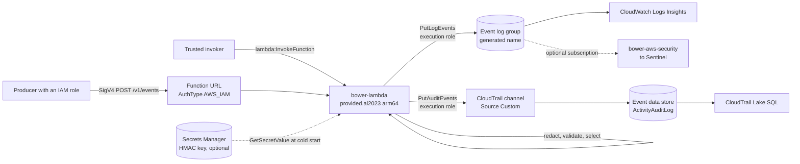

# AWS Lambda host (CloudWatch Logs or CloudTrail Lake)

`bower-lambda` is a native AWS hosting option for Bower. It is a small Rust Lambda that:

- accepts the collector's `/v1/events` request contract, either over a Lambda Function URL
  (`AuthType: AWS_IAM`) or as a direct `Invoke` payload;
- runs the same pipeline as the collector: contract validation, `bower-policy` default-deny
  selection, and the Privacy & Secret Protection Engine (including a privacy profile);
- writes the selected, redacted events to **one destination** per deployment:
  - **Amazon CloudWatch Logs** (`cloudwatch-logs`, recommended): one log event per redacted
    envelope, with `logs:PutLogEvents` on one log group;
  - **AWS CloudTrail Lake** (`cloudtrail-lake`): one audit event per redacted envelope, with
    `cloudtrail-data:PutAuditEvents` on a custom integration channel.

It signs in with nothing but its execution role. No access keys, ingest tokens or Azure
credentials are stored or configured.

> **CloudTrail Lake availability.** AWS closed CloudTrail Lake to new customers from
> 31 May 2026. Accounts that were not using CloudTrail Lake before then cannot create an event
> data store. Use `cloudwatch-logs` (AWS's recommended replacement) unless your account
> already uses CloudTrail Lake.



| Step | Where it happens |
|---|---|
| Collect | The Function URL (verified IAM caller) or direct `Invoke` |
| Select | The packaged policy directory and signed packs (default deny), after producer scopes |
| Arrange | The collector's `SecurityEventProcessor`: redaction before anything else, schema validation, privacy alerts |
| Deliver | `PutLogEvents` or `PutAuditEvents`. An event counts as accepted only after the destination accepts it. |
| Prove | CloudWatch Logs Insights or CloudTrail Lake SQL (see [Query](#query)) |

Test the policies you package offline first: `bower policy test EVENT.json...` (or
`Test-BowerPolicyEvent` from the `Bower.Policy` PowerShell module) runs sample events
through the same intake and prints each decision.

## What is the same as the collector, and what is not

The Lambda builds its policy bundle with the collector's own loader and runs the
collector's processor. The redacted envelope it sends (the CloudWatch Logs message, or
CloudTrail Lake `additionalEventData.envelope`) is **byte-identical** to the one the Rust
collector would queue for the same input. The only difference is the `collector`
context: the host id, a source adapter of `aws-lambda-url:<producer>` or
`aws-lambda-invoke:<producer>`, and the configuration hash. The test
`rust/crates/bower-lambda/tests/collector_parity.rs` proves this, privacy alerts included.
The Rust collector's match with C# is proven by the redaction parity vectors.

Things the Lambda does **not** have, compared with the full collector:

| Collector feature | Lambda |
|---|---|
| Durable SQLite queue and retry worker | None. The caller retries: any event that was not accepted gets a 503 for that event. |
| Tamper-evident ledger, `/v1/status`, evidence bundles | None. The log group or event data store is the store of record. |
| Duplicate detection across requests | Only inside one request. Neither CloudWatch Logs nor CloudTrail Lake deduplicates across requests, so a retried event can appear twice. Deduplicate in queries on `eventId` (`eventData.uid` in CloudTrail Lake). |
| Management heartbeat and maintenance jobs | None |
| Bearer tokens (`BOWER_INGEST_TOKEN*`) | Refused at start-up. IAM is the only authentication. |
| HMAC key file (`BOWER_PRIVACY_HMAC_KEY_FILE`) | Refused at start-up. Use `BOWER_PRIVACY_HMAC_KEY_SECRET_ARN`. |
| Managed privacy profiles (`BOWER_PRIVACY_PROFILE_SOURCE=management`) | Refused at start-up. Package the reviewed profile, exported from the approved version. |
| One host for several ingress paths | One ingress per function. Deploy a second stack for direct `Invoke`. |
| Raw pack parser endpoint (`/v1/packs/.../events`) | Not exposed. Signed packs still add policies and detections. |
| Rate limiting (`BOWER_INGEST_RATE_PER_SECOND`) | Reserved concurrency. Excess calls get Lambda's 429. |
| Sentinel or AMA delivery | Not direct. The destination is CloudWatch Logs or CloudTrail Lake. A `cloudwatch-logs` log group can be subscribed by [`bower-aws-security`](aws.md), whose agent forwards Bower envelopes to a collector (not yet tested end to end with this host). |

## IAM model

There are three layers of access control, and every layer fails closed.

1. **Lambda verifies the caller.** With `AuthType: AWS_IAM`, Lambda checks the SigV4
   signature and the function's resource policy before any Bower code runs. The template
   grants each ARN in `AllowedInvokerPrincipalArns` two permissions:
   `lambda:InvokeFunctionUrl` (with `FunctionUrlAuthType: AWS_IAM`), and
   `lambda:InvokeFunction` limited to calls made through the URL (`InvokedViaFunctionUrl`).
   Since October 2025, new function URLs need both permissions. Callers in another account
   also need an identity policy that allows both actions on the function.
2. **The caller is mapped to a producer.** Lambda puts the caller ARN in
   `requestContext.authorizer.iam.userArn`. The packaged `principals.json` maps IAM role and
   IAM user ARNs to producer ids:

   ```json
   [
     {"principalArn": "arn:aws:iam::123456789012:role/apps/orders-api", "producer": "orders"},
     {"principalArn": "arn:aws:iam::123456789012:user/ci-forwarder", "producer": "ci"}
   ]
   ```

   A role entry matches every session of that role
   (`arn:aws:sts::123456789012:assumed-role/orders-api/<session>`). Assumed-role ARNs leave
   out the role path, so the match uses the account and role name. Matching is exact and
   case-sensitive. Root, federated-user, service and unmapped callers get a 403. The caller
   ARN is never echoed back or logged.
3. **The producer is limited to its event identities.** The packaged producer scopes file
   uses the collector's format and rules (`BOWER_PRODUCER_SCOPES_FILE`): each
   `application`/`source` tuple a producer may claim is listed exactly. An event outside the
   producer's scope gets a 403 for that event, and a producer with no scope is denied
   everything. `BOWER_SINGLE_TRUST_DOMAIN=true` turns these checks off, as it does on the
   collector. It cannot be combined with a scopes file.

**One ingress per deployment.** A function serves either Function URL requests or direct
`Invoke` payloads, never both. To accept both, deploy two stacks (two functions) with their
own principal lists. `BOWER_LAMBDA_INGRESS=both` stops the function at init, and the
template's `IngressMode` only allows `function-url` or `invoke`.

| `IngressMode` | Function URL | Direct `Invoke` | Caller identity |
|---|---|---|---|
| `function-url` (default) | created, `AuthType: AWS_IAM` | not granted by the resource policy; a non-URL payload is refused by the handler | `requestContext.authorizer.iam.userArn`, mapped through `principals.json` (required) |
| `invoke` | not created | granted to `AllowedInvokerPrincipalArns` | none from Lambda: every payload is attributed to `BOWER_LAMBDA_INVOKE_PRODUCER` (required). URL-shaped payloads are refused, so an invoker cannot claim a caller ARN. |

A mismatched setting fails at init: an invoke producer on a URL function, a principals file
on an invoke function, or a missing principals file or producer.

**Residual risk: direct invokes of a URL function.** The handler cannot tell a real Function
URL event from a direct `Invoke` payload shaped like one. In `function-url` mode it trusts the
`userArn` in that payload, and the test
`url_shaped_direct_payload_is_trusted_in_function_url_mode_and_refused_in_invoke_mode`
pins this behaviour. Only IAM keeps direct invokers out.

- The template's resource policy grants `lambda:InvokeFunction` only with
  `InvokedViaFunctionUrl: true`, so it never allows a direct invoke.
- Lambda resource policies can only Allow. A principal **in the same account** whose identity
  policy allows `lambda:InvokeFunction` on the function (or on `*`) can still invoke it
  directly, because no resource policy grant is needed. That principal can assert any mapped
  producer.
- To block it, apply
  [`deploy/aws/policies/bower-lambda-deny-direct-invoke-scp.json`](../../deploy/aws/policies/bower-lambda-deny-direct-invoke-scp.json):
  - Use it as a service control policy on the account, or add its statements to the
    permissions boundary of every role and user in the account.
  - First replace `BOWER_ACCOUNT_ID`, and `BOWER_URL_FUNCTION_NAME` with the stack's
    `FunctionName` output.
  - It denies `lambda:InvokeFunction` on the function unless `lambda:InvokedViaFunctionUrl`
    is true, and it denies the legacy `lambda:InvokeAsync`.
  - It uses `BoolIfExists`, so a missing key counts as a direct invoke. AWS does not
    document whether the key is absent or `false` on direct calls.
- SCPs do not apply to the organisation's management account, and a permissions boundary
  only covers the principals it is attached to. This Deny has not been verified against a
  live account. Test it in a sandbox account with a role that has `lambda:*`. A direct
  `aws lambda invoke` must fail with `AccessDenied`, and the signed URL call must still work.
- Anyone who can change the function, its resource policy or the SCP can remove these
  controls. Keep those permissions with administrators.

**Execution role** (least privilege, defined in the template):

| Permission | Resource |
|---|---|
| `logs:CreateLogStream`, `logs:PutLogEvents` (`cloudwatch-logs`) | this stack's event log group only |
| `cloudtrail-data:PutAuditEvents` (`cloudtrail-lake`) | this stack's channel ARN only |
| `logs:CreateLogStream`, `logs:PutLogEvents` | this stack's function log group only |
| `secretsmanager:GetSecretValue` (optional) | `PrivacyHmacKeySecretArn` only |
| `kms:Decrypt` (optional) | `PrivacyHmacKeySecretKmsKeyArn`, only through `secretsmanager.<region>.amazonaws.com` |

Only the grant for the chosen destination is created. `PutAuditEvents` must be called from
the account that owns the channel, so the function and the channel live in the same account.

## Request and response

The body is the collector's `POST /v1/events` body: one Bower envelope, at most 1 MiB, JSON
nesting depth 64, sent with `Content-Type: application/json` or `application/*+json`.

As an additive extension, the body may also be a JSON array of **1 to 100 envelopes**. Each
element is handled exactly as if it were its own `/v1/events` request. A direct `Invoke`
payload is the body itself.

Status codes per event follow the collector:

| Status | Meaning |
|---|---|
| 202 | Selected, redacted, and **every** required record (the event and each privacy alert) accepted by the destination |
| 200 | Duplicate of an earlier element in the same request whose complete required set was accepted |
| 422 | Rejected by policy, or a required record (the event **or** a privacy alert) refused for good: by CloudTrail Lake (`InvalidData`, `FieldTooLong` and similar) or locally (`cloudtrail-lake-event-too-large`, `cloudwatch-logs-event-too-large`). `queued` is `false`; resending cannot succeed. |
| 400 | Quarantined (schema, redaction or validation failure), or a malformed body |
| 403 | The caller or producer is not allowed (see the IAM model) |
| 409 | Identity conflict inside the request (same id, different content) |
| 413 / 415 / 404 / 405 | Body too large or more than 100 elements / wrong content type / path other than `/v1/events` / method other than `POST` |
| 503 | **Retry this event.** A required record was not accepted yet (throttling, internal failure, access or network error, a CloudWatch Logs timestamp rejection, or a missing result) |

How an element's status is decided:

- An element is successful only when every audit event it requires was accepted. That means
  the source event and every privacy alert it raised.
- If anything is still retryable, the element is 503, even when another record was refused.
  It converges: once nothing is retryable any more, a refusal gives 422.
- A duplicate depends on its original's complete set of required records, plus any records
  of its own. This applies to a same-id duplicate and to a fingerprint alias (the same
  `eventOriginalId` and content under another `eventId`).
- A duplicate is therefore 503 and listed in `retryIndexes` when its original is 503, and
  422 when its original is 422. It is never acknowledged unless the original was fully
  accepted.

A single-envelope request returns the collector's ingest response fields (`eventId`,
`decision`, `queued`, `duplicate`, `reasons`, `policy`) plus `retryable` and `delivery`.
`delivery` has one entry per record (the event and its privacy alert): `auditEventId` (the
record id), `eventId`, `status` (`accepted`, `retry` or `refused`), `cloudTrailEventId`
(CloudTrail Lake only) and `errorCode`.

A batch returns `207` with `results[]`, where each result carries its own `index` and
`status`. If any element must be retried, the batch returns `503` instead, and
`retryIndexes` lists the elements to send again. Resend only those. A direct `Invoke`
returns `{"statusCode": <status>, "body": <response>}`.

Use synchronous `RequestResponse` invocations. With asynchronous (`Event`) invocations the
response is thrown away, so retryable failures would be lost.

Responses and logs never contain payload values, tokens or caller ARNs. Logs record one line
per invocation with counts and failure codes.

## CloudWatch Logs log events

Each accepted event, and each privacy alert, becomes one log event:

| Field | Value |
|---|---|
| `message` | The redacted envelope exactly as the collector queues it (JSON, one line) |
| `timestamp` | The invocation's receive time. The event's own time stays in the message as `timeGenerated`, so old events are never refused as too old and one call never spans 24 hours. |

The function writes to one stream per execution environment, named after the runtime's own
log stream (`AWS_LAMBDA_LOG_STREAM_NAME`) unless `BOWER_CLOUDWATCH_LOG_STREAM` is set, and
creates it at init. Calls are split at 10,000 events or 1,048,576 bytes (messages plus 26
bytes each). An envelope above the 1 MB log event limit is refused locally with
`cloudwatch-logs-event-too-large` (status 422); it is never sent truncated. A log event
CloudWatch Logs rejects for its timestamp (`rejectedLogEventsInfo`) is retryable: a retry
restamps it.

## CloudTrail Lake audit event mapping

Each accepted event, and each privacy alert, becomes one `AuditEvent`:

| Field | Value |
|---|---|
| `id` | The Bower `eventId` when it matches `[-_A-Za-z0-9]{1,128}`; otherwise `bower-<sha256 hex of eventId>`. It is stable, so a retry sends the same id. |
| `eventDataChecksum` | base64 SHA-256 of `eventData` |
| `eventData.version` | envelope `schemaVersion` |
| `eventData.userIdentity` | `type` = actor type (`human`, `service`, ..., `unknown`); `principalId` = redacted `actor.userId`, else `actor.username`, else `unknown`; `details.producer` = producer id |
| `eventData.eventSource` | `bower.<application.name>`, with characters outside `[A-Za-z0-9._-]` replaced by `-` |
| `eventData.eventName` | envelope `eventType` |
| `eventData.eventTime` | `timeGenerated` in UTC, `yyyy-MM-ddTHH:mm:ssZ` |
| `eventData.UID` | the Bower `eventId` |
| `eventData.errorCode` / `errorMessage` | `failure` or `denied`, and the redacted `eventOutcomeReason`, for failed or denied events |
| `eventData.sourceIPAddress` | `source.ipAddress` when it is still a valid IP after redaction |
| `eventData.recipientAccountId` | the channel's account |
| `eventData.additionalEventData` | `envelope` (the redacted envelope exactly as the collector queues it), `privacy` (detector ids and actions only), and `omittedFields` when present |

Values are taken from the envelope **after** redaction and policy. The handler never maps the
raw candidate.

Every string field is cut to its CloudTrail limit, counted in bytes so the character limit
also holds. `additionalEventData` is limited to 28 kB (counted as 28,000 bytes). When it is
over, the free-form `attributes` bag is left out and `omittedFields: ["attributes"]` is
recorded. If it is still over, the event is refused locally with
`cloudtrail-lake-event-too-large` (status 422). It is never sent truncated.

Calls are split so that each `PutAuditEvents` request holds at most 100 events and stays
under 1 MB. That size counts `eventData` after JSON escaping.

## Settings

| Variable | Default | Purpose |
|---|---|---|
| `BOWER_LAMBDA_DESTINATION` | required | `cloudwatch-logs` or `cloudtrail-lake`. Settings of the other destination are refused at init. |
| `BOWER_CLOUDWATCH_LOG_GROUP` | required for `cloudwatch-logs` | Log group name (`[A-Za-z0-9._/#-]`, 1-512) |
| `BOWER_CLOUDWATCH_LOG_STREAM` | runtime log stream name | Optional fixed stream (no `:` or `*`). Concurrent environments may share one stream. |
| `BOWER_CLOUDTRAIL_CHANNEL_ARN` | required for `cloudtrail-lake` | `arn:aws:cloudtrail:<region>:<account>:channel/<id>`. The account becomes `recipientAccountId`. |
| `BOWER_CLOUDTRAIL_RECIPIENT_ACCOUNT_ID` | channel account | Optional. Must equal the channel account. |
| `BOWER_CLOUDTRAIL_EXTERNAL_ID` | — | Optional `externalId` for channels whose resource policy requires one |
| `BOWER_LAMBDA_INGRESS` | `function-url` | `function-url` or `invoke`. `both` is refused at init. |
| `BOWER_LAMBDA_PRINCIPALS_FILE` | — | IAM principal to producer map. Required with `function-url`; refused with `invoke`. |
| `BOWER_LAMBDA_INVOKE_PRODUCER` | — | Producer for every direct `Invoke` payload. Required with `invoke`; refused with `function-url`. |
| `BOWER_PRIVACY_PROFILE_SOURCE` | `local` | Only `local`. `management` (managed profiles) and any other value stop the function at init: package a reviewed privacy profile, exported from the approved management version. |
| `BOWER_PRODUCER_SCOPES_FILE` | — | Collector producer scopes. If it is missing, every event is denied unless single trust domain is on. |
| `BOWER_SINGLE_TRUST_DOMAIN` | `false` | As on the collector |
| `BOWER_POLICY_DIRECTORY` | `./policies/default` | Packaged policies |
| `BOWER_PACKS`, `BOWER_PACK_TRUSTED_KEYS` | — | Packaged signed packs and trusted public keys, as on the collector |
| `BOWER_PRIVACY_PROFILE` | — | Packaged privacy profile, read by the collector's loader, so it supports whatever the collector's profile schema supports |
| `BOWER_PRIVACY_HMAC_KEY_SECRET_ARN` | — | Secrets Manager ARN of the HMAC key (base64, or at least 32 raw bytes, in `SecretString` or `SecretBinary`) |
| `BOWER_PRIVACY_HMAC_KEY_ID` | `k1` | Key id stamped into HMAC pseudonyms |
| `BOWER_COLLECTOR_ID` | function name | `collector.id` in envelopes |
| `RUST_LOG` | `info` | Log level |

Any invalid setting, an unreadable file, a profile that needs an HMAC key without one, or a
failure to read the secret stops the function at init. It never serves with part of its
configuration. The key is read once per execution environment and held only in memory. After
you rotate the secret, publish a new version or update the configuration to force new
environments.

## Build and package

The function runs on `provided.al2023` for `arm64`. The executable must be called
`bootstrap` and sit at the root of the zip:

```bash
# Recommended: cargo-lambda (uses Zig for the Linux arm64 cross build)
cd rust
cargo lambda build --release --arm64 -p bower-lambda
# -> target/lambda/bootstrap/bootstrap

# Alternative: cargo-zigbuild with the target installed through rustup
rustup target add aarch64-unknown-linux-gnu
cargo zigbuild --release --target aarch64-unknown-linux-gnu.2.34 -p bower-lambda
# -> target/aarch64-unknown-linux-gnu/release/bootstrap
```

Lay out the package with the binary and the read-only configuration it loads from
`/var/task`:

```text
bootstrap.zip
├── bootstrap                     # the binary, mode 0755
├── policies/default/*.yaml       # copied from the repository policies/ directory
├── principals.json               # IAM principal -> producer
├── producer-scopes.json          # producer -> allowed event identities
├── privacy/<profile>.yaml        # optional
└── packs/*.bowerpack, keys/*.pem # optional, signed packs and trusted public keys
```

```bash
mkdir -p package && cp target/lambda/bootstrap/bootstrap package/
cp -R ../policies package/policies
cp principals.json producer-scopes.json package/
(cd package && zip -r -X ../bootstrap.zip .)
aws s3 cp bootstrap.zip s3://acme-bower-artifacts/bower-lambda/0.1.0/bootstrap.zip
```

Never put secrets in the package. The HMAC key comes from Secrets Manager. The package is
configuration, so review changes to it the way you review policy changes.

## Deploy with a change set

The template is [`deploy/aws/bower-aws-lambda.yaml`](../../deploy/aws/bower-aws-lambda.yaml)
(or use `Deploy-BowerAwsLambda` from the `Bower.Deployment` PowerShell module). It uses
`AWS::LanguageExtensions` (`Fn::ForEach` over the invoker ARNs), so it needs
`CAPABILITY_AUTO_EXPAND` as well as `CAPABILITY_IAM`. Review the change set before you run
it:

```bash
aws cloudformation create-change-set --region ap-southeast-2 \
  --stack-name bower-lambda --change-set-name initial \
  --change-set-type CREATE \
  --template-body file://deploy/aws/bower-aws-lambda.yaml \
  --capabilities CAPABILITY_IAM CAPABILITY_AUTO_EXPAND \
  --parameters \
    ParameterKey=CodeS3Bucket,ParameterValue=acme-bower-artifacts \
    ParameterKey=CodeS3Key,ParameterValue=bower-lambda/0.1.0/bootstrap.zip \
    'ParameterKey=AllowedInvokerPrincipalArns,ParameterValue="arn:aws:iam::123456789012:role/apps/orders-api"' \
    ParameterKey=Destination,ParameterValue=cloudwatch-logs \
    ParameterKey=EventLogRetentionDays,ParameterValue=365

aws cloudformation describe-change-set --region ap-southeast-2 \
  --stack-name bower-lambda --change-set-name initial
aws cloudformation execute-change-set --region ap-southeast-2 \
  --stack-name bower-lambda --change-set-name initial
```

`Destination` has no default: every create and update must name it, so an update can never
switch an existing stack to another destination by omission. For CloudTrail Lake, pass
`Destination=cloudtrail-lake` and `RetentionDays=<7-3653>` instead of the event log
settings. Template rules refuse settings of the other destination.

> **Upgrading a stack from `bower-aws-cloudtrail-lake.yaml`.** Pass
> `Destination=cloudtrail-lake` (and your existing `RetentionDays`). Changing destination
> later leaves the previous event log group or event data store in place: both are retained
> evidence, and neither is reused if you switch back.

The stack creates:

- for `cloudwatch-logs`, the event log group with `EventLogRetentionDays` and an optional
  KMS key (`EventLogKmsKeyArn`; its key policy must allow the CloudWatch Logs service). Its
  name is generated (the `EventLogGroupName` output) and it has `DeletionPolicy: Retain`, so
  deleting the stack keeps the evidence and recreating it never collides with the old group;
- for `cloudtrail-lake`, an event data store (`ActivityAuditLog` selector, single region,
  `RetentionDays`, extendable retention pricing, termination protection on, optional KMS
  key; `DeletionPolicy: Retain`) and a custom integration channel (`Source: Custom`)
  delivering to it;
- the function's own log group with `LogRetentionDays`;
- the execution role described above;
- the function (`provided.al2023`, `arm64`, reserved concurrency, recursive loop
  detection on);
- for `function-url`, a Function URL with `AuthType: AWS_IAM`, plus per-invoker grants of
  `lambda:InvokeFunctionUrl` (`FunctionUrlAuthType: AWS_IAM`) and `lambda:InvokeFunction`
  (`InvokedViaFunctionUrl: true`);
- for `invoke`, per-invoker grants of `lambda:InvokeFunction`, and no URL.

A template rule requires `InvokeProducer` with `IngressMode=invoke` and requires it to be
empty with `function-url`. To offer direct `Invoke` as well, deploy a second stack with
`IngressMode=invoke`, its own `AllowedInvokerPrincipalArns` and `InvokeProducer`, and set
`ExistingChannelArn` to the first stack's `ChannelArn` output (`cloudtrail-lake`). The second
stack then creates no event data store or channel, so both functions write to the same
store. With `cloudwatch-logs` each stack has its own event log group; query both. CloudTrail allows
at most one channel per source. For a URL stack, apply the
[direct-invoke Deny](#iam-model) after deployment.

The template refuses regions other than `ap-southeast-2` and `ap-southeast-4` unless you set
`EnforceAustralianRegion=false`.

Validation status: `cfn-lint` 1.57.2 (the CI version) passes. `ValidateTemplate` needs AWS credentials, so it
was not run, and Bower's test suite does not deploy the template.

## Send an event

Callers sign with SigV4 for the service `lambda` in the function's region, for example with
curl's built-in signer and the caller role's temporary credentials:

```bash
curl --aws-sigv4 "aws:amz:ap-southeast-2:lambda" \
  --user "$AWS_ACCESS_KEY_ID:$AWS_SECRET_ACCESS_KEY" \
  -H "x-amz-security-token: $AWS_SESSION_TOKEN" \
  -H "Content-Type: application/json" \
  --data @event.json "${FUNCTION_URL}v1/events"
```

Bower's forwarders (`Bower.Forwarding`) send bearer tokens to a collector. They do not sign
requests for Lambda, so use the collector for them.

## Query

### CloudWatch Logs

Query the `EventLogGroupName` output with CloudWatch Logs Insights. The messages are Bower
envelopes, so their fields are discovered automatically. Illustrative; not run against a
live log group:

```text
fields @timestamp, eventId, timeGenerated, application.name, actor.userId, source.ipAddress
| filter eventType = "authentication_failure"
| dedup eventId
| sort timeGenerated desc
| limit 100
```

### CloudTrail Lake

Find the event data store id (the last part of the `EventDataStoreArn` output) and query with
CloudTrail Lake SQL. The examples below are illustrative. They have not been run against a
live event data store.

```sql
-- Recent Bower authentication failures, newest first, one row per Bower event
SELECT eventData.uid, eventData.eventTime, eventData.eventSource,
       eventData.userIdentity.principalId, eventData.sourceIPAddress
FROM <event-data-store-id>
WHERE eventData.eventName = 'authentication_failure'
  AND eventTime > '2026-10-01 00:00:00'
GROUP BY eventData.uid, eventData.eventTime, eventData.eventSource,
         eventData.userIdentity.principalId, eventData.sourceIPAddress
ORDER BY eventData.eventTime DESC

-- Privacy controls applied (detector ids only, never values)
SELECT eventData.eventTime, element_at(eventData.additionalEventData, 'privacy')
FROM <event-data-store-id>
WHERE eventData.eventName = 'sensitive_data_detected'
```

## Limits

- No durable queue: if the destination is unavailable, events return 503 and the caller must
  retry. Nothing is buffered in the function.
- At most 1 MiB and 100 envelopes per request. For CloudTrail Lake a redacted envelope must
  fit 28 kB of `additionalEventData`, or 28 kB without `attributes`; for CloudWatch Logs it
  must fit one 1 MB log event.
- Neither destination deduplicates across requests. Retries can store duplicates, so
  deduplicate on `eventId` (`eventData.uid` in CloudTrail Lake).
- Neither destination has been exercised against a live AWS account by Bower's tests; the
  sinks are tested through fakes and the template with `cfn-lint`.
- Direct `Invoke` has a single producer identity, and only in an `invoke` deployment (see
  the IAM model).
- A URL function can be invoked directly by same-account principals with identity-policy
  `lambda:InvokeFunction`, and they can then assert any mapped producer. Close this with the
  shipped SCP or permissions-boundary Deny (see the IAM model).
- Redaction runs inline on the invocation's CPU. Size `MemorySize` for your largest payloads.
- Linux arm64 cross builds were not run in the Bower development environment for this change
  (no `aarch64-unknown-linux-gnu` standard library or cargo-lambda installed). Build with
  cargo-lambda in CI before deploying.
