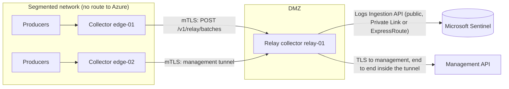

# Relay (aggregator) mode

Issue #110 (epic #116). Some collectors sit in segmented or DMZ networks with no route to
Azure. A **relay** is a collector inside the boundary that does have a route. Downstream
collectors send it events that are already redacted and decided. The relay keeps them in
its own durable queue and delivers them to the Logs Ingestion API. It can also carry the
downstreams' management traffic through a tunnel to the management API.



This is Vector's agent and aggregator topology
([topologies](https://vector.dev/docs/setup/deployment/topologies/)), with Bower's
contract: the hop never changes an event, never re-parses source data and never loses an
acknowledged event.

## What the relay does and does not do

- It accepts batches only from downstream collectors it knows. Each one has a client
  certificate whose SHA-256 pin is in the relay's downstreams file. The TLS handshake
  refuses every other certificate.
- It stores each payload byte for byte. The downstream already ran redaction and policy;
  the relay does not redact again and does not run parsers, so it never holds raw data.
  It still validates every envelope (default deny, below).
- A downstream can only act as the collector id its pin names. A batch or envelope that
  names any other collector is refused.
- Its delivery from its own queue is the normal `QueueDeliveryWorker`: leases, retries,
  dead letters and the destination circuit work as on any collector.
- Each downstream batch request has a 60-second deadline covering response headers and
  body. A timeout acknowledges nothing and holds the batch for retry behind the
  destination circuit.
- The management tunnel goes to the relay's own `BOWER_MANAGEMENT_ENDPOINT` and nowhere
  else. Downstreams cannot name a target. TLS to management runs inside the tunnel, so the
  relay sees only ciphertext: it cannot read or change heartbeats, enrolment tokens,
  assertions or commands.
- One hop only. A relay cannot deliver to another relay, and there is no mesh routing.
- No inbound connections to downstream collectors. Downstreams connect out to the relay.

## Configure the relay

The relay is a normal collector (same image, same `BOWER_*` settings, any output except
`relay`) with a second listener.

| Variable | Purpose |
|---|---|
| `BOWER_RELAY_LISTEN_URL` | `https://<address>:<port>` for downstreams, for example `https://0.0.0.0:4443`. Separate from `BOWER_LISTEN_URL`. Always mutual TLS, HTTP/1.1. An explicit port is required. |
| `BOWER_RELAY_CERTIFICATE_FILE` / `BOWER_RELAY_KEY_FILE` | PEM server certificate and private key for that listener. |
| `BOWER_RELAY_DOWNSTREAMS_FILE` | JSON file of downstream collector ids and client certificate pins (below). Read at start-up; restart to apply a change. |
| `BOWER_RELAY_MANAGEMENT_TUNNEL` | `true` lets downstreams open a byte tunnel to this relay's `BOWER_MANAGEMENT_ENDPOINT`. Off by default. Cannot be combined with `BOWER_MANAGEMENT_PROXY`: the tunnel connects directly. |
| `BOWER_OUTPUT` | `azure-logs-ingestion` in production (`ama-spool` also works). Not `relay`. |

```json
{
  "downstreams": [
    { "collectorId": "edge-01", "certificateSha256": "3f2a…64 hex digits…" },
    { "collectorId": "edge-01", "certificateSha256": "9c41…the next certificate, during rotation…" },
    { "collectorId": "edge-02", "certificateSha256": "AB:CD:…openssl output is accepted…" }
  ]
}
```

Rules: 1 to 1024 entries, file at most 256 KiB, each pin used once, collector ids of 1 to
128 printable characters without spaces. A collector id may have more than one pin, so a
downstream can rotate its certificate without downtime. Remove a pin and restart the relay
to revoke a downstream.

The relay accepts a pinned certificate only inside its validity period and, when the
certificate restricts its key usage, only with `clientAuth`. The pin is the trust anchor,
so self-signed client certificates are fine.

## Configure a downstream collector

| Variable | Purpose |
|---|---|
| `BOWER_OUTPUT=relay` | Deliver to the relay instead of Azure. |
| `BOWER_RELAY_URL` | `https://relay.dmz.example:4443`. No path, query or credentials. |
| `BOWER_RELAY_CLIENT_CERTIFICATE_FILE` / `BOWER_RELAY_CLIENT_KEY_FILE` | PEM client certificate and key. The key stays on this host. |
| `BOWER_RELAY_CA_BUNDLE` | Optional extra roots for the relay's server certificate, merged with the system roots. Host name and chain checks always apply. |
| `BOWER_MANAGEMENT_VIA_RELAY` | `true` sends every management request (enrolment, heartbeat, credential rotation, privacy profile) through the relay's tunnel. Requires `BOWER_MANAGEMENT_AUTH=enrolment`: an Entra token needs a route to Entra ID, which a collector behind a relay lacks. Cannot be combined with `BOWER_MANAGEMENT_PROXY`. |

Keep `BOWER_MANAGEMENT_ENDPOINT` the management URL itself, not the relay: management's
certificate is verified end to end (`BOWER_MANAGEMENT_CA_BUNDLE` still applies).
Environment proxies (`HTTPS_PROXY`) never apply to the relay hop.

## Certificates

With OpenSSL 3:

```bash
# On the relay: a private CA and the listener certificate (or use your organisation's PKI).
openssl req -x509 -newkey ec -pkeyopt ec_paramgen_curve:P-256 -nodes -days 825 \
  -subj "/CN=Bower relay CA" -keyout relay-ca.key -out relay-ca.pem \
  -addext basicConstraints=critical,CA:TRUE -addext keyUsage=critical,keyCertSign,cRLSign
openssl req -newkey ec -pkeyopt ec_paramgen_curve:P-256 -nodes \
  -subj "/CN=relay.dmz.example" -keyout relay.key -out relay.csr
printf 'subjectAltName=DNS:relay.dmz.example\nextendedKeyUsage=serverAuth\nbasicConstraints=CA:FALSE\n' > relay.ext
openssl x509 -req -in relay.csr -CA relay-ca.pem -CAkey relay-ca.key -CAcreateserial \
  -days 397 -extfile relay.ext -out relay.crt

# On each downstream: its own client certificate. Copy only the pin to the relay.
openssl req -x509 -newkey ec -pkeyopt ec_paramgen_curve:P-256 -nodes -days 397 \
  -subj "/CN=edge-01" -keyout relay-client.key -out relay-client.crt \
  -addext extendedKeyUsage=clientAuth
openssl x509 -in relay-client.crt -noout -fingerprint -sha256
```

Give `relay-ca.pem` (not its key) to downstreams as `BOWER_RELAY_CA_BUNDLE`. Keep key files
owner-only (`0600`).

## Management through the relay

With `BOWER_RELAY_MANAGEMENT_TUNNEL=true` on the relay and `BOWER_MANAGEMENT_VIA_RELAY=true`
on a downstream:

1. The downstream opens mutual TLS to the relay and sends
   `GET /v1/relay/management-tunnel` with `Upgrade: bower-management-tunnel/1`.
2. The relay checks the pin, connects to its own management host and port, answers
   `101 Switching Protocols` and copies bytes both ways.
3. The downstream starts TLS to management inside the tunnel and sends its request with
   its own credential.

Token enrolment ([collector enrolment](../architecture/collector-enrolment.md)) works
unchanged through the tunnel: the downstream lands in `Pending`, an approver approves it,
and its heartbeats report it `Active`. Commands stay signed by management and bound to the
downstream's collector id. The relay is a separate collector record with its own identity.

## Delivery guarantees across the hop

The at-least-once rule of `Bower.Forwarding` holds across the hop:

| Step | Guarantee |
|---|---|
| Downstream leases events | They stay in its queue until settled. Nothing is deleted before acknowledgement. |
| Relay receives a batch | Each event is committed (SQLite WAL, `synchronous=FULL`) before the relay answers. |
| Relay answers `accepted` or `duplicate` | Only then does the downstream mark the event delivered, with acknowledgement `relay:<relayId>:ledger:<sequence>`. |
| Relay answers `rejected` | Permanent. The downstream dead-letters it as `relay-rejected:<code>`, where its owner sees it. |
| Relay unreachable, busy or full | The downstream keeps every event behind the destination circuit (`destination-relay-*`) without spending attempt budgets. |
| Response lost, or relay restarted | The downstream resends. The relay finds each event by id and fingerprint and answers `duplicate`; nothing is queued twice. |

Deduplication on the relay lasts while the delivered row is retained
(`BOWER_QUEUE_RETENTION_HOURS`, default 7 days), so keep the relay's retention at least as
long as a downstream outage you plan for. Delivery from the relay to Azure is
at-least-once exactly as on any collector: a relay that crashes mid-upload can upload a
batch again after the lease expires.

Malformed relay responses, unknown result statuses and missing per-event results hold
unacknowledged events behind the destination circuit (`destination-relay-response-invalid`
or `destination-relay-result-missing`). They do not spend the event retry budget. Only an
explicit `rejected` result is permanent. Valid accepted/duplicate results in an incomplete
response can still be acknowledged; later batches wait for the destination to recover.

## Evidence across the hop

- The relay stores the downstream's payload unchanged, so both queue ledgers commit to the
  same `payload_sha256` for each event id. `bower queue verify` on each queue proves each
  chain; comparing the hashes proves the relay carried exactly what the downstream stored.
- The downstream's acknowledgement names the relay and the relay ledger head that covered
  the batch.
- `bower evidence run --collector-url <downstream>` sends the canary to the downstream. It
  crosses the relay like any event and is then queried out of Sentinel, so the bundle
  proves delivery end to end through the relay. The Sentinel row keeps the downstream's
  `CollectorId`.

## Wire contract

`POST /v1/relay/batches` (body at most 8 MiB):

```json
{"schemaVersion":1,"collectorId":"edge-01",
 "events":[{"eventId":"…","fingerprint":"sha256:v2:…","payload":{ …the stored envelope… }}]}
```

Response `200`:

```json
{"schemaVersion":1,"relayId":"relay-01","ledger":{"sequence":42,"hash":"…"},
 "results":[{"eventId":"…","status":"accepted"},{"eventId":"…","status":"rejected","code":"collector-mismatch"}]}
```

The relay checks, in order, for every event: payload at most 1 MiB (`payload-too-large`),
a valid envelope (`payload-invalid`), its `eventId` (`event-id-mismatch`), its
`collector.id` equal to the authenticated downstream (`collector-mismatch`), an accepting
policy decision in `security.decision` (`policy-decision-missing`), and the fingerprint
recomputed from the envelope (`fingerprint-mismatch`). The same id with different content
is `event-identity-conflict`.

| Status | Meaning | Downstream failure code |
|---|---|---|
| `200` | Per-event results | `relay-rejected:<code>` for rejected events |
| `400`, `413` | Malformed or oversized batch | `relay-http-<status>` (attempt budget applies) |
| `403` | Batch names another collector | `destination-relay-http-403` |
| `429` | 8 batches already in progress (`Retry-After: 1`) | `destination-relay-http-429` |
| `503` | Relay queue full (`Retry-After: 30`) or storage error (`Retry-After: 5`) | `destination-relay-http-503` |
| TLS or connection failure | Unpinned or expired certificate, untrusted relay, relay down | `destination-relay-unavailable` |

`GET /v1/relay/management-tunnel`: `404` when the tunnel is off, `400` without the upgrade,
`429` past 64 tunnels (4 per downstream), `502` when management is unreachable from the
relay, otherwise `101`. A tunnel closes after 2 minutes idle or 15 minutes in total; the
downstream reconnects as needed.

## Monitoring

`GET /v1/status` on the relay (ingest token required) adds a `relay` section: per pinned
downstream, batches, accepted, duplicates, rejected and the last batch time, plus open,
opened and refused tunnel counts. Metadata only. The downstream's own status and heartbeat
report its output as `relay` with the usual queue depth and oldest undelivered age.

## Private Link and ExpressRoute

The relay is the only host that needs a path to Azure. See
[Private Link and ExpressRoute](../operations/doctor-and-dcr.md#private-link-and-expressroute)
for a private-only data collection endpoint behind an Azure Monitor Private Link Scope, or an
ExpressRoute path, and for checking it with `bower doctor`.

## Limits and known gaps

| Item | Limit |
|---|---|
| Events per batch | 500 (the downstream also stops at 4 MiB of payload) |
| Request body | 8 MiB |
| Payload | 1 MiB |
| Concurrent batches | 8 per relay |
| Tunnels | 64 per relay, 4 per downstream |
| Downstreams | 1024 pins |

- Each relayed event is its own queue transaction, so a relay commits roughly as many
  events per second as its disk can fsync. Size relays for the aggregate rate.
- Queue capacity (`BOWER_QUEUE_MAX_BYTES`) is shared: there is no per-downstream quota,
  so one busy downstream can hold the relay at capacity and the others then wait (their
  events stay safely in their own queues).
- The tunnel connects to management directly; a relay that itself needs a proxy to reach
  management cannot offer the tunnel yet.
- Pins and certificates are read at start-up; changes need a restart. There is no
  revocation list beyond removing the pin.
- Rust collector differences from the C# specification (pinned in
  `rust/crates/bower-collector/tests/relay.rs`):
  - `BOWER_MANAGEMENT_VIA_RELAY` runs the tunnel client through a Unix domain socket in an
    owner-only `management-relay` directory next to the queue, so it is Unix-only; on other
    platforms the Rust collector refuses to start with it. Relaying events works everywhere.
  - A host name in `BOWER_RELAY_LISTEN_URL` binds `0.0.0.0` (IPv4) rather than dual stack.
    Use an explicit address (`[::]` for IPv6) when it matters.
  - Relay response fields are matched case-sensitively (C# reads them case-insensitively).
    Bower relays always send camelCase, so this only affects non-Bower relays.
  - On shutdown the relay listener stops at once instead of waiting for in-flight batches;
    an interrupted batch was never acknowledged, so the downstream resends it.
- The relay trusts the downstream's redaction and policy decision; it checks the envelope
  carries one but cannot prove the downstream's privacy profile was correct.
