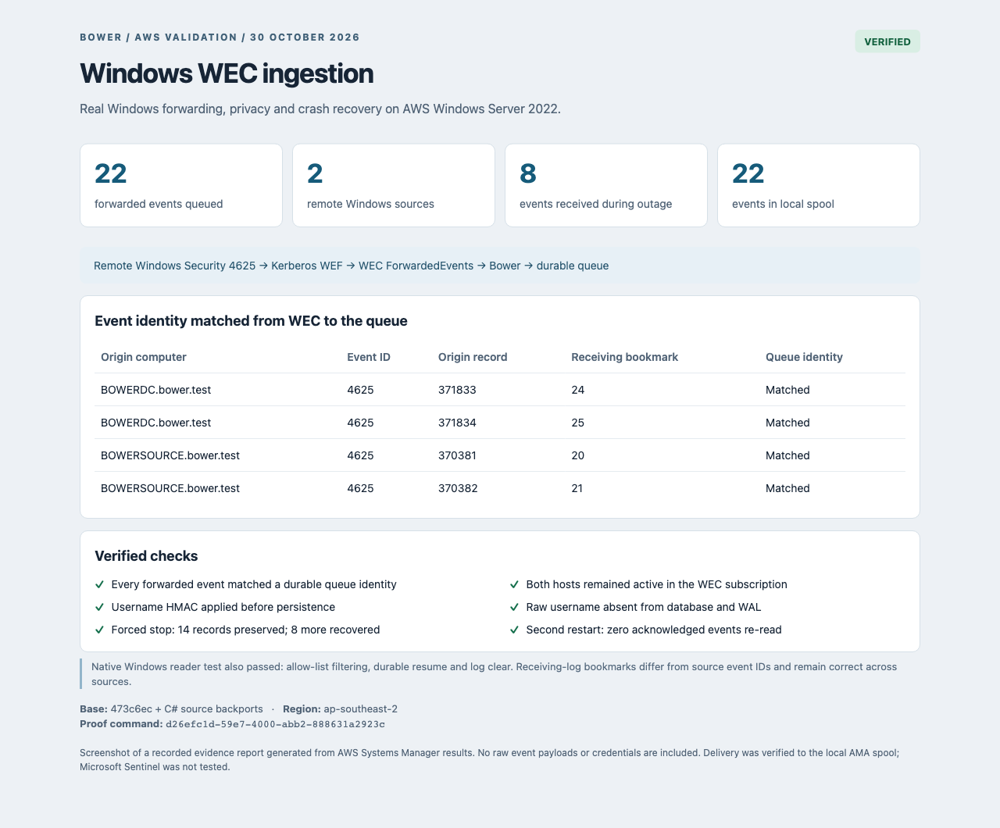
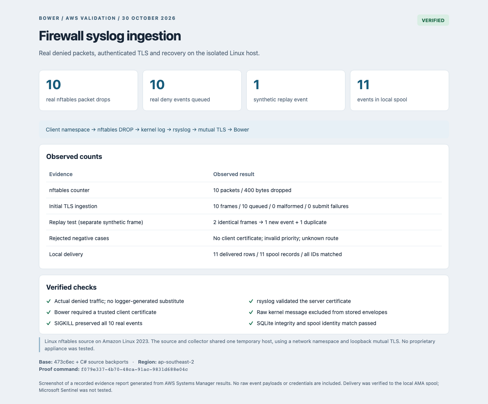

# AWS native-source validation — 30 October 2026

The user selected `473c6ec6ffb9c195d49c54caae1267bd069c548f` and requested missing
Windows and syslog adapters be added to that base. The work remains on
`feat/wec-syslog-473c6ec`. No newer main version was deployed.

The first AWS run used the unchanged commit and passed its collector, cloud-agent
and management-console checks. Its [original evidence](base-run.json) includes
618 .NET tests, 10 UI tests, privacy, crash recovery, SQS replay and 201 records
delivered to a local AMA spool. That run's infrastructure was independently
verified deleted before the native-source lab was created.

## Deployment and provenance

The native-source stack was `bower-wec-20261030-023813` in AWS account
`959038055523`, region `ap-southeast-2`. Three Windows Server 2022 `t3.medium`
instances provided a domain controller, member source and separate WEC host.
One Amazon Linux 2023 `t3.small` instance provided the firewall and syslog
collector. An isolated security group allowed traffic only among lab members,
with no public inbound rules. Administration used SSM. All four disks were
encrypted and IMDSv2 was required. A three-hour termination guard bounded the
host lifetime; explicit teardown was requested after evidence capture.

The collectors were self-contained **managed .NET 10 x64** publications, not
Native AOT. Host-side hashes matched the uploaded packages:

- [Published artifact hashes](artifact-manifest.json), [Windows host hash](windows-artifact.json), [Linux host hash](linux-artifact.json).
- [Reviewed source fingerprints](source-manifest.json), based on `473c6ec` plus the working-tree backport. Documentation/comments were finalized after publication.
- [Live infrastructure audit](infrastructure.json): host identities, AMIs, instance types, encrypted volumes and security-group rules.
- [Successful proof command index](capture-summary.json): SSM IDs and retained output.

## Windows WEC: real forwarding and durable resume

1. Created an isolated `bower.test` domain, joined the source and WEC hosts,
   and configured a source-initiated WEC subscription restricted to Security
   event 4625 from `Microsoft-Windows-Security-Auditing`.
2. Granted Network Service read access to the source Security log, enabled
   logon-failure auditing and configured the WEF SubscriptionManager. Transport
   used domain authentication over WinRM HTTP; no TLS-verification bypass was
   used. Both sources reported active subscriptions with error code zero.
3. Generated controlled failed SMB network logons using test identities.
   Windows emitted the events; no event XML was injected into `ForwardedEvents`.
4. Bower read `ForwardedEvents` through the Windows API and the trusted signed
   `windows-security-logon` 1.0.2 pack. Fourteen initial events from two remote
   origins matched their queue identities. Usernames were pseudonymized with a
   host-generated HMAC key, and the raw username was absent from payloads,
   database and WAL.
5. Force-stopped Bower, generated eight more remote failures, and verified that
   WEC received them while Bower was offline. Restarting Bower recovered all
   eight, giving 22 matched events. A further restart preserved the identity-set
   digest and read zero old events.
6. Enabled local AMA spool output and matched all 22 delivered rows to all 22
   spool records. SQLite integrity checks passed.

The review found an important WEC distinction: the origin EventRecordID is not
the receiving log's cursor. For example, source record `371834` had receiving
bookmark `25`; records from the other source had lower origin IDs. The backport
uses native receiving-log bookmarks for seeking and preserves origin data for
stable event identity.

Proof: [baseline identities and privacy](wec-baseline.json),
[recovery and delivery summary](wec-recovery.json),
[full before/after evidence and final collector status](wec-export.json),
[native Windows reader test output](native-windows-test.json).

## Firewall syslog: real denied packets and mutual TLS

1. Created a client namespace connected by a veth pair to the Linux host. An
   nftables input rule counted, logged and dropped UDP traffic to port 4444.
2. Sent ten real packets. The kernel counter reported ten drops / 400 bytes.
   rsyslog forwarded the resulting kernel messages as RFC 5424 over mutual TLS.
   Bower required a client certificate signed by the temporary CA; rsyslog
   validated the server name and certificate.
3. A temporary signed `nftables-validation` pack selected only the deny marker,
   normalized `network_connection_denied` semantics, and retained the source
   address and bounded reason. The raw kernel message was not persisted.
   Ten frames produced ten queued events with zero parse or submission errors.
4. SIGKILL preserved all ten real records. A separate synthetic frame, sent
   twice, produced one additional event and one duplicate. Missing client
   certificate, invalid syslog priority and unknown app route were rejected.
5. All eleven records matched the local AMA spool, including the one explicitly
   synthetic replay event.

Proof: [actual packet and ingestion counts](firewall-ingestion.json),
[recovery, negative cases, replay and delivery](firewall-recovery.json).

The screenshots are browser captures of **recorded evidence reports** built from
the retained SSM results. They are not Windows Event Viewer or AWS Console
screenshots. The corresponding [WEC HTML](wec.html) and [syslog HTML](syslog.html)
are retained for inspection. No raw security-event payloads or credentials are
included in these reports.

## Checks and deliberate review

- Release build passed with zero warnings/errors.
- Local test run: 759 total, 758 passed, one Windows-only test skipped on macOS.
  That native Windows test passed separately on the AWS WEC host.
- `dotnet format --verify-no-changes --no-restore` and `git diff --check` passed.
  The [check summary](local-checks.json) also records screenshot provenance.
- Reviewed collector wiring, optional-setting compatibility, signed-pack trust,
  bounded transforms and parsing, TLS client trust, cursor ownership, durable
  acknowledgement, backpressure, cancellation, status privacy, schemas, pack
  samples, fixtures, documentation and the temporary deployment/test scripts.
- Existing tests cover malformed input, bounds, TLS rejection, backpressure and
  cursor failure/recovery. Real-host checks cover WEC forwarding, native log
  reading, mixed-source cursor positions, process crashes and local delivery.
- No new NuGet dependency was added. Temporary deployment keys stayed on their
  hosts; the local test signing private key was removed after use. Public TLS
  fixture keys in unit tests are test data, not deployment credentials.

Initial setup attempts exposed harness issues: the Amazon Linux package is
`rsyslog-openssl`, domain join had to wait for AD readiness, and the standalone
xUnit executable uses `-class`. These were corrected and the recorded final
checks passed. The first malformed-frame recovery attempt closed its TCP
connection as designed; the successful negative test used a framed message
with an invalid priority. Failed attempts were not counted as passes.

## Scope and limits

This validates the C# backport. Rust source adapters, Native AOT publication,
large-scale/load endurance, a proprietary firewall appliance and Microsoft
Sentinel ingestion were not tested. Syslog has no application-level durable
acknowledgement; TLS/TCP and sender queues do not establish exactly-once delivery.
The firewall and collector shared one Linux host with loopback TLS. The test
identities and traffic were controlled, while the Windows and kernel events were
generated by the real operating systems. UI checks are from the unchanged-base
run; no UI behavior changed in the backport. The base's known development-only
undici advisory was preserved; the initial production-only audit reported zero.

## Cleanup

**All temporary lab resources were removed.** The independent
[cleanup audit](cleanup.json), completed at `2026-10-30T03:09:19Z`, confirmed:

- CloudFormation stack `DELETE_COMPLETE` and all four EC2 instances terminated.
- All four encrypted EBS volumes, the security group and artifact bucket deleted.
- All three IAM roles, both instance profiles, the temporary domain secret and
  expiry schedule deleted.

No temporary deployment remains running. The existing VPC and subnet are shared
account infrastructure and were retained. SSM/CloudFormation history and these
local proof files are retained as evidence; they are not running lab resources.
