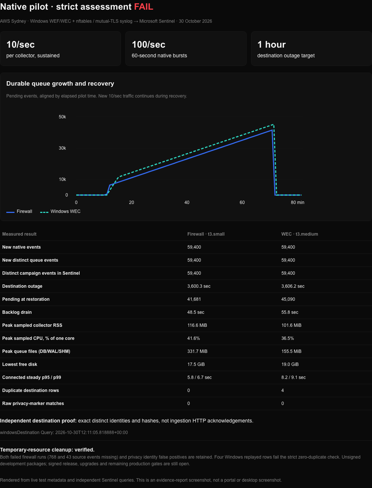

# Native pilot qualification — 30 October 2026

**Distinct-event delivery reconciled for both collectors; strict assessment failed
on four Windows replayed rows. No production approval is implied.** The final
firewall attempt passed every host and destination check. Earlier source-loss
failures remain below. [Temporary-resource cleanup is verified](cleanup.json).

| Measured result | Firewall (`t3.small`) | Windows WEC (`t3.medium`) |
| --- | ---: | ---: |
| Native / accepted / distinct destination events | 59,400 / 59,400 / 59,400 | 59,400 / 59,400 / 59,400 |
| Extra destination rows | 0 | 4 |
| Actual destination outage | 3,600.34 sec | 3,606.15 sec |
| Pending at restoration | 41,681 | 45,090 |
| Backlog drain with continued 10/sec input | 48.51 sec | 55.78 sec |
| Connected steady ingestion p95 / p99 | 5.79 / 6.65 sec | 8.23 / 9.08 sec |
| Peak sampled collector RSS | 116.6 MiB | 101.6 MiB |
| Peak sampled CPU, percent of one core | 41.60% | 36.53% |
| Raw destination privacy-marker matches | 0 | 0 |

[Assessment](assessment.json) · [Independent destination query](destination-query.json)
· [Recorded report](report.html)

The screenshot renders live test metadata and independent query results. It is
an evidence-report screenshot, not a Windows desktop or cloud-portal screenshot.

The selected scope is 10 events/sec per collector, 100/sec bursts for 60 seconds,
and a real one-hour destination outage. Each complete run generates 59,400 events,
with 41,400 scheduled in the outage phases and 6,000 in recovery with live traffic.
The [profile](../../../lab/aws/pilot-envelope.json) and
[reproduction guide](../../../lab/aws/PILOT.md) define the phases and acceptance
checks. Synthetic traffic uses actual Windows Security 4625 records forwarded by
WEF to WEC, and actual nftables packet denials forwarded by rsyslog over mutual TLS.

The packages remain the original CI artifacts from commit
`26446690fae7d123e2dfaf117d63467f1f55d37d`, CI run `41016990194`.
The harness branch starts from `d9a29efbfc77d824494be7119515a5579e010476`.
[Artifact hashes](artifact-manifest.json) distinguish the first failed Linux
script, corrected script and final native probe. The MSI is **not signed**.
The [host manifest](host-proof.json) records Windows Server 2022, restricted
service accounts, a `t3.medium` WEC/DC/source and `t3.small` firewall.
The [firewall fixture proof](firewall-fixture-proof.json) confirms that the public
validation pack reproduces the deployed parser, policy, privacy and sample bytes,
policy hashes and generated DCR; both local pack sample tests passed.

AWS run: `bower-pilot-20261030-084844`, Sydney. Azure validation uses subscription
`945092a0-2500-4b25-85a4-99f1c3135906`, tenant
`f4f33fb1-b681-40d1-a854-6f888d45b891`, resource group
`rg-bower-val-20261030-084842`, workspace
`a5ba4598-1f56-4b1d-a320-77bb7c28a48c`. The temporary resources have been removed.
The [access checks](azure-access-check.json) verify publisher-query denial,
verifier-query success, and verifier-ingestion denial.

## Preflight and failures retained

- The [first firewall attempt](failed-linux-attempt.json) generated 12,000 real
  packets but failed before the outage because the harness nftables declaration
  lacked a required separator. Its stop-time snapshot contained 8,420 accepted
  and acknowledged events; later buffered arrivals are not included in that
  snapshot. The [baseline audit](linux-baseline-audit.json) found 11,232 eventually
  accepted events and no prior-attempt arrivals after the safety boundary preceding
  the rerun: 768 of the original 12,000 events had not been accepted. The corrected
  run records a separate initial population; its result cannot erase this loss.
- rsyslog reported `imjournal` rate limiting with its default 20,000 messages per
  600 seconds, including 769 dropped input messages. Reconnect diagnostics consume
  that budget too. The corrected fixture uses a bounded 200,000/600-second input
  allowance. The second attempt retained `RebindInterval="1"`, a disk-assisted
  action queue with save-on-shutdown, and retries.
  The earlier idle-close loss finding remains relevant; syslog has no durable
  application acknowledgement, so each actual sender needs qualification.
- The [second firewall attempt](failed-linux-second-attempt.json) completed a
  3,600.2-second outage and drained 43,995 pending events in 19.0 seconds, but
  accepted only 59,357 of 59,400 new native events. A later
  [settled queue check](failed-linux-second-settled.json) confirmed the 43 missing
  events were not simply late arrivals. An
  [independent destination query](failed-linux-second-destination-query.json)
  matched all 70,589 accepted identities, including the 11,232-event baseline.
  Successful delivery of accepted events does not erase this source loss.
- [rsyslog diagnostics](rsyslog-diagnostics.json) recorded tens of thousands of
  reconnect messages. Bower reported no rejected connections, parser errors or
  dropped frames, locating the loss before frame acceptance without proving its
  exact mechanism. The next [sender configuration](sender-configuration.json)
  uses a persistent mutually authenticated connection and a bounded 3,600-second
  listener idle timeout. Its [preflight](persistent-sender-preflight.json)
  accepted and acknowledged all 1,100 native events, including a 75-second idle
  gap. The full rerun below passed; this does not cover hour-long idle gaps or resets.
- Windows domain-controller forwarding initially lacked the Domain Controllers
  group in the WEC subscription ACL. Twenty LDAP trial failures generated before
  that correction are excluded from the subsequent synchronized preflight and
  pilot windows. They are not claimed as delivered.
- The first 1,000-event generator preflight produced native records but its report
  failed because Windows PowerShell cannot serialize integer-keyed dictionaries.
  The harness now serializes LDAP codes as string keys. A repeated
  [1,000-event preflight](preflight-generator.json) completed in 10.000905 seconds,
  returning only LDAP result 49.
- The [source](preflight-source.json) and [WEC](preflight-wec.json) probes reconcile
  both 1,000-event preflight populations, totaling 2,000 events. Queue-specific
  fields in the source-host report do not establish queue checks on that host.
  Independent Sentinel queries matched the persisted identity digest
  `66bb157354cd9ef4a1a21c2a96b0e53d68b90b380165ba319483182e17ad580b`.
- The default privacy detectors masked one generated event ID as a false positive.
  The verifier now retains the original native digest, applies the tested default
  identity redaction, and compares the resulting IDs with queue and destination.
  There were no identity collisions in the preflight. This does not establish that
  every possible generated identity is collision-free after redaction.

## Windows result

The [generator](windows-generator.json) completed all 59,400 native authentication
failures at the declared sustained and burst rates, returning only LDAP result 49.
The [source](windows-source.json), [WEC and queue](windows-wec.json), and independent
Sentinel query matched all 59,400 distinct campaign identities with digest
`39f03f8b76011275f129dde03089a2448d97b01c83809c1291d1fdede033ab0f`.
There were no missing native identities, unexpected queue identities, dead letters,
raw synthetic usernames in DB/WAL, or raw privacy-marker matches in Sentinel.
The default privacy detectors changed 31 generated IDs; transformed native IDs
matched the persisted set without collisions. This remains a privacy-detector
false-positive finding, not proof that all possible identities are collision-free.

The [monitor](windows-monitor.json) measured 3,606.15 seconds of destination
isolation, 45,090 pending events at restoration and a 55.78-second backlog drain
while new traffic continued. All 59,400 campaign events were acknowledged by the
end. Peak sampled collector RSS was 101.6 MiB and CPU was 36.53% of one core;
queue database/WAL/SHM peaked at 155.5 MiB. These are sampled process metrics,
not whole-host peaks. Connected steady-state ingestion p95/p99 were 8.23/9.08
seconds over 5,998 events in the source-time window; phase-boundary timestamps
place two events in the next window without losing them.
The Windows monitor samples about every five seconds and does not export the
precise firewall creation/removal timestamps. Its measured outage duration and
retained queue population establish those observations; scheduled source-phase
boundaries do not prove an exact event count inside the firewall interval.

Sentinel contains **59,404 campaign rows for 59,400 distinct identities**.
[Replay timing](windows-duplicate-proof.json) shows four IDs ingested at
09:39:02 UTC and again at 10:39:25 UTC. This is consistent with an ambiguous
acknowledgement at the outage boundary followed by at-least-once retry; the query
does not expose the transport acknowledgement itself. The strict zero-duplicate
assessment fails and is retained. Supplemental distinct-identity observations
cannot override that verdict. Production queries and detections must account for
replay rather than assume exactly-once delivery.
The [tested deduplication query](windows-dedup-query.json) returns exactly 59,400
rows for this campaign. It does not establish exactly-once alert execution across
overlapping scheduled-query windows.

## Final firewall result

The [final campaign](linux-pilot.json) generated 59,400 real denied packets at the
declared rates and accepted all 59,400. Its 71,689-event initial accepted population
includes earlier attempts and the 1,100-event persistent-connection preflight.
The [settled queue proof](linux-settled-proof.json) and independent Sentinel query
match all 131,089 accepted identities with digest
`2e4437892c3bc4e09a23032c6999c366933c7f6ac4ad9e0028a29aca89303ffd`.
The source-time-scoped campaign independently contains exactly 59,400 distinct
destination events, excluding prior attempts. This prevents old buffered arrivals
from compensating for missing new events.

The collector retained 41,681 events through a measured 3,600.34-second outage and
drained that backlog in 48.51 seconds while 10/sec traffic continued. All accepted
events were acknowledged, SQLite integrity passed, and there were no dead letters
or sampling errors. [Queries during isolation](linux-outage-destination-observations.json)
show an unchanged destination identity set while the local queue grew.

[Source counters](linux-source-status.json) show one persistent mutually
authenticated connection and 60,500 frames received/queued (1,100 preflight plus
59,400 campaign), with no timeout, TLS, parse, malformed-frame or drop counters.
There are zero duplicate destination rows and zero raw privacy-marker matches.
The source loss seen with per-event reconnects did not recur in this measured
window; its exact mechanism is not proven by that comparison. Peak queue files
(database/WAL/SHM) were 331.7 MiB, with at least 17.5 GiB free disk.

## Review and checks

The final review covers harness failure handling, source and destination identity
reconciliation, replay visibility, secret exclusion, executable provenance and
documentation limits. The 43 Python lab tests and 21 CI-selection tests passed;
the native proof probe passed locked restore, Release build and formatting checks;
workflow lint passed; both firewall pack samples passed. The earlier solution
build/tests/format and PowerShell syntax/analyzer checks also passed during this
campaign. Live qualification is reported separately: its strict verdict is failed
because Windows has four duplicate rows, despite complete distinct-event coverage.

## Limits

This is a qualification of a narrowly declared synthetic workload on the recorded
hosts and signed parser profiles. It does not certify proprietary appliances,
arbitrary payload distributions, longer outages, power loss, queue saturation,
signed production installation, populated upgrades, certificate/key rotation,
restore/replay, operational alerts or a multi-day soak. See the
[production gates](../../operations/production-readiness.md).

The final report must retain failures and cleanup proof. A successful SSM command,
an ingestion HTTP 2xx, or a green unit-test run cannot substitute for native and
destination identity reconciliation.

## Cleanup

The [independent cleanup audit](cleanup.json) verifies the AWS stack and all its
resources deleted, all four instances terminated, no tagged volumes or subnet
interfaces remaining, the Azure resource group absent, and both temporary app
identities absent. Temporary Azure certificates/keys, isolated CLI caches and
local signing keys are removed. The operator's normal Azure login is preserved.
The shared VPC and NAT remain available.

The [bounded expiry extension](expiry-extension.json) allowed the full firewall
rerun after the second failure. The [Windows hosts were retired](windows-retirement.json)
as soon as their proof was complete. Final cleanup removed the expiry schedule
and all remaining owned infrastructure; the expiry guard is not the cleanup proof.
