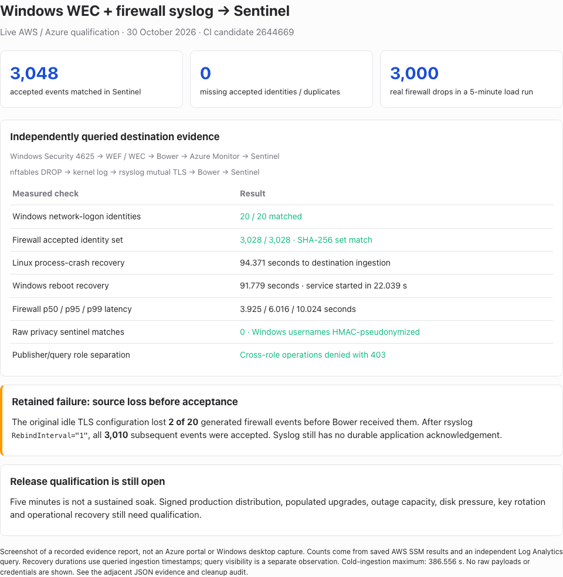

# Windows WEC and firewall syslog to Microsoft Sentinel

**Live validation passed for 3,048 accepted events. Production release gates remain open.**
An independent Log Analytics reader queried 20 Windows network-logon events and
3,028 firewall events from `BowerSecurity_CL`. Every accepted identity matched;
there were no duplicate rows, unexpected identities, semantic mismatches or matches
for the raw privacy sentinels. This is real destination evidence, not simulated
upload success or an AMA spool result.

The original syslog sender configuration lost **two of 20 generated firewall
events before collector acceptance** after an idle TLS connection closed. That
finding is not hidden by the successful accepted-event reconciliation. Subsequent
tests using rsyslog `RebindInterval="1"` accepted all 3,010 generated events.
Syslog still has no application-level durable acknowledgement.

## Exact candidate and deployment

- CI artifact commit: `26446690fae7d123e2dfaf117d63467f1f55d37d`,
  [CI run 41016990194](https://github.com/jusso-dev/Bower/actions/runs/41016990194).
  [PR #158](https://github.com/jusso-dev/Bower/pull/158) merged the same candidate
  as `2250bd190e326db99bb5333cbbdfde04ff9f8801`. This advances the earlier
  `473c6ec` backport validation; it does not relabel those earlier binaries.
- AWS: account `959038055523`, `ap-southeast-2`, run
  `bower-prod-20261030-071434`. Three private Windows Server 2022 `t3.medium`
  instances provided AD, WEC and the source. An Amazon Linux `t3.small` ran
  nftables, rsyslog and the RPM collector. Encrypted disks, SSM administration,
  no public instance addresses and an independent three-hour expiry guard.
- The first stack rolled back because VPC/internet-gateway quotas were exhausted.
  The successful stack created its own private subnet and security group in an
  existing VPC and used an existing NAT gateway. Neither shared resource was deleted.
  CloudFormation validation passed; cfn-lint reported only the deliberately fixed
  NAT-matching availability-zone warning W3010.
- Azure: subscription `945092a0-2500-4b25-85a4-99f1c3135906`, tenant
  `f4f33fb1-b681-40d1-a854-6f888d45b891`, `australiaeast`, resource group
  `rg-bower-val-20261030-065244`. Workspace customer ID:
  `c609a7de-e838-4563-8d45-57800ca2a9a7`. Microsoft Sentinel onboarding succeeded.
- Installed MSI/RPM version `0.1.0-dev.264`, running as `NT SERVICE\Bower` and
  `bower`, respectively. Windows delayed automatic start was disabled. Packages
  were CI development artifacts, not trusted signed production releases.
- Signed packs: `windows-security-logon` 1.0.2 and the isolated
  `nftables-validation` 1.0.0 pack. Only public trust material accompanied the packs.
  Publisher certificate files were readable by the collector service accounts;
  the query identity and its private key remained on the validation controller.
- Recovery settings: `BOWER_DELIVERY_LEASE_SECONDS=90`,
  `BOWER_DELIVERY_TIMEOUT_SECONDS=60`. Default settings remain 300/240 seconds.

See [artifact hashes](artifact-manifest.json) and [host metadata/proof](host-proof.json).

## Results

| Test | Observed result | Limit |
| --- | --- | --- |
| Windows native path | Remote Security 4625 → Kerberos WEF → WEC `ForwardedEvents` → signed pack → queue → Sentinel: 20 matching identities | One Windows source in this campaign; the earlier report tested two |
| Selection/privacy | Twenty local logon events without a source IP were intentionally unselected. All 20 selected network failures had HMAC usernames; the raw synthetic username was absent from DB/WAL and destination envelopes | A synthetic sentinel test, not a certification of every detector |
| Firewall native path | Network namespace UDP traffic → nftables DROP → kernel log → rsyslog → loopback mutual TLS → queue → Sentinel | Shared firewall/collector host; no proprietary appliance |
| Original idle behavior | 20 generated drops, 18 accepted; no intake drop counter increment | Two frames never reached the collector |
| Reconnect profile | Ten recovery events plus 3,000 load events all accepted after `RebindInterval="1"` | Adds TLS connection overhead; not a general lossless-delivery claim |
| Linux crash recovery | Ten queued events during blocked outbound HTTPS; SIGKILL and restart; all reached Sentinel within 94.371 seconds of the fault | Arrival uses independently queried `ingestion_time()`, not process health or upload acknowledgements |
| Windows reboot recovery | Ten durably queued events; process killed and host rebooted; all reached Sentinel within 91.779 seconds; service started in 22.039 seconds | One measured reboot with the candidate MSI |
| Short load | 3,000 real drops at 10/sec for 300.033 seconds; 3,000 new rows; zero undelivered; DB/WAL 8,135,096 bytes at completion | Five minutes is not a sustained soak or a one-hour outage-buffer test |
| Destination identity set | 3,048 rows: 20 Windows + 3,028 firewall; no missing, unexpected or duplicate identities | Acceptance boundary excludes the two recorded upstream losses |
| Firewall latency | p50 3.925 s, p95 6.016 s, p99 10.024 s; maximum 386.556 s | Includes cold initial ingestion and recovery, not just steady-state load |
| Negative intake | Missing client certificate, invalid framing and malformed syslog rejected; no additional queued events | Explicit live cases, not exhaustive adversarial testing |
| Azure permissions | Publisher query 403; verifier query 200; verifier ingestion 403 | Publisher scoped to DCR; reader scoped to workspace |

[Query summary](destination-query.json), [queried event metadata](destination-events.json),
[recovery calculations](recovery.json), [access separation](azure-access-check.json).
Sorted firewall event IDs from the local durable queue and independent destination
query have the same SHA-256 digest. Native Windows record identities are individually
listed in `host-proof.json`. No raw payloads, credentials or private keys are retained.

The query projected only event ID/type, policy hash, event/ingestion times and a
boolean privacy check:

```kusto
BowerSecurity_CL
| project EventId, EventType, PolicyHash, TimeGenerated,
    Ingested=ingestion_time(),
    RawPrivacyMatch=tostring(RawEnvelope) contains "bower-probe"
        or tostring(RawEnvelope) contains "BOWER_DENY"
```

Recovery durations subtract the recorded fault timestamp from the latest destination
ingestion timestamp for the ten recovery identities. They do not claim that queries
became searchable within that same interval; query observation time is recorded
separately. Early queries returned no rows during cold destination initialization.

## Fixes and retained failures

The real Bicep deployment initially failed with `InvalidStreamDeclaration`: DCR
timestamp fields require `datetime`, while table schema fields require `dateTime`.
The old test lowercased both and hid the mismatch. The strengthened exact-case test
failed before the fix, all 22 DCR tests passed afterward, and Azure what-if/apply
succeeded with the corrected template.

The first outage precondition failed because only eight of ten idle-reconnect
messages queued. The original source loss remains a release consideration even
though the subsequent reconnect profile passed. Test each intended sender/appliance
and its retention/replay behavior before rollout.

Harness corrections are distinguished from product failures: initial AD/DNS readiness
caused a failed join/download; deleting a nonexistent WEC subscription aborted setup;
a local logon fixture did not match the signed network-logon policy; an immediate
source-log read preceded audit-log flush; a malformed-frame check initially expected
the parser counter instead of the framing counter. Corrected attempts passed without
weakening the pack, authentication, privacy or source allow-list.

## Screenshots and cleanup

The report image below renders recorded AWS/Log Analytics evidence. It is not an
Azure portal or Windows desktop screenshot.



Temporary AWS/Azure resources and test credentials were removed after capture;
[independent cleanup proof](cleanup.json) passed for all checks. The user's Azure
CLI login and shared AWS VPC/NAT are preserved. Azure service deletion may retain
recoverable soft-deleted metadata under the platform's normal retention rules.

## Remaining release work

This campaign advances the [readiness gates](../../operations/production-readiness.md).
It does not qualify a production workload/outage envelope, disk exhaustion, source
rollover under load, key rotation, signed release distribution, populated upgrades,
restore/replay or operational alert response. A native signed `bower evidence run`
canary bundle was not run here; this report provides separate independently queried
native-event reconciliation. Release status remains **not production-ready**.

Final local checks: build passed with zero warnings/errors; formatting passed;
1,869 tests total, 1,868 passed and one native Windows test skipped on macOS.
The exact candidate's required CI, native Windows and installer checks had already
passed before PR #158 was merged. Final diff and evidence review are recorded in
the follow-up PR.
