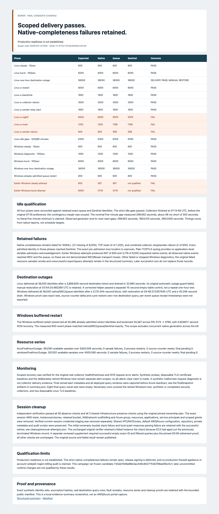

# Final candidate qualification evidence

Run `bower-ws6-20261101-011000`. Generated `2026-11-01T07:24:58.061652+00:00`.

**Production readiness is not established.** Exact passes apply only to their recorded scope.

| Phase | Expected | Native | Queue | Sentinel | Outcome |
|---|---|---|---|---|---|
| Linux steady · 10/sec | 600 | 600 | 600 | 600 | PASS |
| Linux burst · 100/sec | 6000 | 6000 | 6000 | 6000 | PASS |
| Linux one-hour destination outage | 36000 | 36000 | 36000 | 36000 | DELIVERY PASS; MANUAL RESTORE |
| Linux a-restart | 6000 | 6000 | 6000 | 6000 | PASS |
| Linux a-blackhole | 1800 | 1800 | 1800 | 1800 | PASS |
| Linux a-collector-reboot | 3000 | 3000 | 3000 | 3000 | PASS |
| Linux a-sender-stop-start | 1800 | 1800 | 1800 | 1800 | PASS |
| Linux a-sigkill | 6000 | 6000 | 5979 | 5979 | FAIL |
| Linux a-reset | 1200 | 1200 | 1196 | 1196 | FAIL |
| Linux a-sender-reboot | 600 | 600 | 598 | 598 | FAIL |
| Linux idle gaps · 5/30/65 minutes | 6300 | 6300 | 6300 | 6300 | PASS |
| Windows steady · 10/sec | 600 | 600 | 600 | 600 | PASS |
| Windows diagnostic · 100/sec | 1000 | 1000 | 1000 | 1000 | PASS |
| Windows burst · 100/sec | 6000 | 6000 | 6000 | 6000 | PASS |
| Windows one-hour destination outage | 36000 | 36000 | 36000 | 36000 | PASS |
| Windows already-admitted queue restart | 600 | 600 | 600 | 600 | PASS |
| Earlier Windows steady attempt | 600 | 567 | 567 | not qualified | FAIL |
| Earlier Windows burst attempt | 6000 | 3179 | 3179 | not qualified | FAIL |

## Idle qualification

All four pulses were reconciled against retained exact queue and Sentinel identities. The strict idle gate passed. Collection finished at 07:13:49 UTC, before the original 07:35 preference; the contingency margin was unused. The nominal five-minute gap measured 299.952 seconds, about 48 ms short of 300 seconds; no literal five-minute minimum is claimed. Observed generator end-to-next-start gaps: 299.952 seconds, 1804.015 seconds, 3903.945 seconds. Timings come from native reports, not schedule targets.

## Retained failures

Native completeness remains failed for SIGKILL (21 missing of 6,000), TCP reset (4 of 1,200), and combined collector-stop/sender-reboot (2 of 600). Every admitted identity in those phases reached Sentinel. The exact pre-admission loss location is unproven. Plain TCP/TLS syslog provides no application-level durable-admission acknowledgement. Earlier Windows attempts produced 567 of 600 and 3,179 of 6,000 requested native events; all observed native events reached WEC and the queue, so these are not demonstrated WEC/Bower transport losses. Other failed or stopped Windows diagnostics, the original failed resource-sampler smoke and unsuccessful export/query attempts remain in the structured summary. Later successful runs do not replace those records.

## Destination outages

Linux delivered all 36,000 identities after a 3,888.609-second destination block and drained in 32.860 seconds. Its original automatic outage guard failed; manual restoration at 03:54:24.465269 UTC is retained. A corrected helper passed a separate 15-second empty-table control, not a repeat one-hour test. Windows delivered all 36,000 native/WEC/queue identities after a 3,731.344-second block, with restoration at 04:48:27.0357445 UTC and a 45.246-second drain. Windows proof uses exact sets, source-counter delta and a pre-restore zero-row destination query; per-event queue receipt timestamps were not exported.

## Windows buffered restart

The Windows buffered restart preserved all 50,366 already-admitted winevt identities and bookmark 50,367 across PID 3172 → 3760, with 5.604617-second SCM recovery. The measured 600-event phase matched native/WEC/queue/Sentinel exactly. This scope excludes concurrent native generation across the kill.

## Resource series

linuxFinalHourOutage: 361/361 available samples over 5400.006 seconds; 0 sample failures, 0 process restarts, 0 source-counter resets; final pending 0. windowsFinalHourOutage: 301/301 available samples over 4500.085 seconds; 0 sample failures, 0 process restarts, 0 source-counter resets; final pending 0.

## Monitoring

Scoped recovery was verified for the original real-collector health/freshness and DCR request-error alerts. Synthetic probes, disposable TLS-certificate baselines and the deliberately retired Windows host remain separate alert scopes; no all-alerts-clear claim is made. A synthetic malformed-request diagnostic is not collector delivery evidence. Final owned alert metadata and all deployed query windows were captured before Azure teardown; see the finalSnapshot artifacts in summary.json. Eight final query result sets were empty. Nonempty rows covered the retired Windows host, synthetic or completed-security collectors, and two disposable Linux TLS baselines.

## Session cleanup

Independent verification passed all 26 absence checks and all 3 shared-infrastructure presence checks using the original pinned ownership plan. The exact session AWS stack, instances/volumes, retained bucket, IAM/network scaffolding and Azure group, resources, applications, service principals and scoped grants were removed. Verified current-session credential staging was removed separately. Shared VPC/NAT/routes, default AWS/Azure configuration, repository, private metadata and audit scripts were preserved. The initial nonempty-bucket stack failure and local quiet-response parsing failure are retained with the successful retries; see cleanup/removal-attempts.json. The unchanged original verifier retained a failed instance-list check because EC2 had aged out the previously terminated Windows record. A separate reviewed supplement required successful empty exact-ID and filtered queries plus the pinned 05:09 retirement proof; all other checks are unchanged. The original source and failed result remain published.

## Qualification limits

Production readiness is not established. The strict native-completeness failures remain open, release signing is deferred, and no production firewall appliance or account-wide/all-region billing audit is claimed. This campaign ran frozen candidate 733eb7448a98e3ac449c8427753b799ad3fec5c1; later uncommitted runtime changes are not qualified by these results.

## Retained proof and reproduction

- [Structured summary and source hashes](summary.json).
- [Exact identity evidence and offline verifier](identity-evidence/README.md).
- [Resource series and offline verifier](resource-evidence/README.md).
- [Actual fault execution evidence](fault-evidence/README.md).
- [Linux outage temporal proof](firewall-outage-temporal-proof.json) and [Windows outage temporal proof](windows-outage-temporal-proof.json).
- [Windows buffered restart proof](windows-buffered-restart-proof.json).
- [Observed idle timings and collection receipts](firewall-idle-proof.json).
- [Independent cleanup proof, verifier provenance and offline checks](cleanup/README.md).
- [Bounded public manifest](public-manifest.json), including byte counts and SHA-256 hashes.
- [Rendered report](report.html), [actual local HTML screenshot](report.png), and [screenshot provenance](render-receipt.json).

The screenshot is a real headless Chrome render of this local evidence summary, not an AWS/Azure portal capture. Public files contain synthetic identities, timestamps and bounded metadata, not raw event XML, payloads, queue databases or credentials. Historical per-phase cleanup flags describe their capture time; the final cleanup section records the campaign result.

