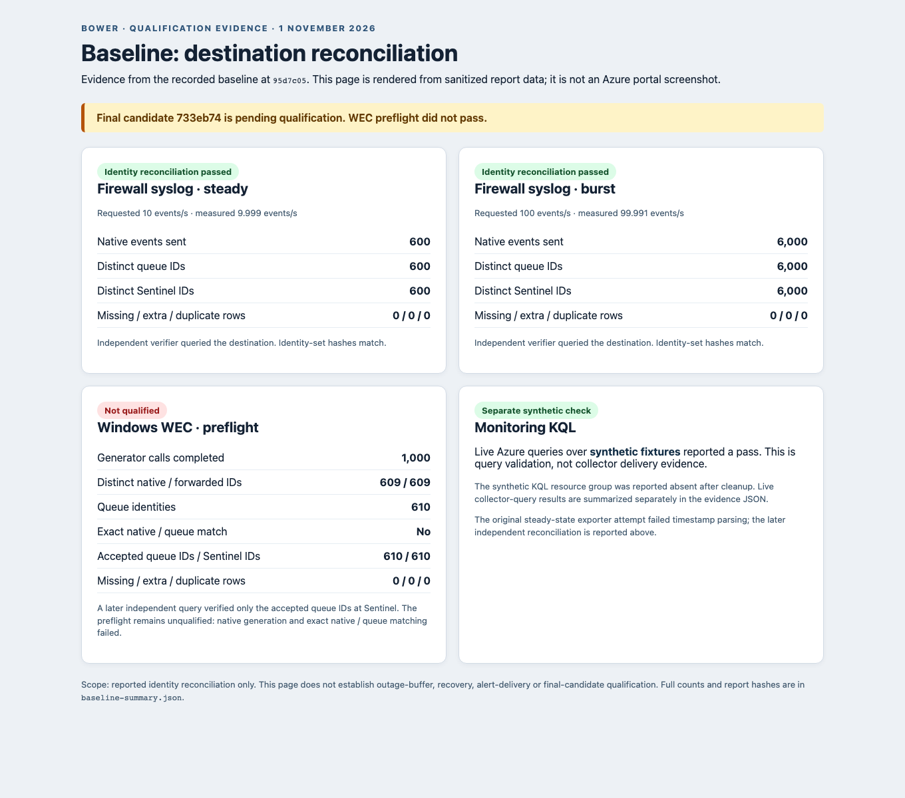

# Baseline evidence: AWS hosts to Microsoft Sentinel, 1 November 2026

**This is baseline evidence for commit `95d7c05dc5bf5bb10c5865ae37bd32d21a27e8b5`. The later candidate `733eb7448a98e3ac449c8427753b799ad3fec5c1` is pending qualification.** These results do not establish production readiness, the one-hour outage buffer, or delivery on the later candidate.

[View the rendered report](baseline-report.html) · [View the report screenshot](baseline-report.png) · [Machine-readable redacted counts and hashes](baseline-summary.json)

The screenshot is a Playwright rendering of the accompanying HTML report, generated from the sanitized JSON summary. It is **not** a screenshot of the Azure portal. The summary omits subscription, workspace, application and collector identifiers, credentials, payloads, and private keys. Its source-report SHA-256 values identify the original private reports; those reports are not included here, so their hashes alone do not make the underlying observations independently reproducible.

## Firewall syslog identity reconciliation

The recorded test generated syslog traffic on AWS and independently queried the Sentinel destination. The result reports compare event identity sets, rather than inferring delivery from collector acceptance. These are two separate runs, not a continuous one-hour outage test.

| Baseline scenario | Native events sent | Distinct queue IDs | Distinct Sentinel IDs | Missing at Sentinel | Sentinel IDs absent from queue | Duplicate Sentinel rows | Measured source rate |
| --- | ---: | ---: | ---: | ---: | ---: | ---: | ---: |
| Steady | 600 | 600 | 600 | 0 | 0 | 0 | 9.9991 events/s |
| Burst | 6,000 | 6,000 | 6,000 | 0 | 0 | 0 | 99.9913 events/s |

For each scenario the report marks `identityComplete`, `strictPass`, and `destinationQueryVerified` true, and identifies the query role as `verifier`. The expected, queue and destination identity-set hashes match within each scenario; see the JSON for exact hashes, plan and pack hashes, and query cutoffs. This verifies the reported identity reconciliation only: fault injection, topology, alert delivery and duration require separate evidence.

The **first steady-state export attempt failed evidence validation**: its report recorded 600 native events and 600 locally accepted events, but zero parsed queue rows and 600 malformed rows. The recorded cause under investigation was Python 3.9 parsing of .NET timestamps with seven fractional-second digits. That attempt explicitly did not qualify Sentinel delivery. The later attempt is the reconciliation reported in the table; the failed attempt is not rewritten as a pass.

## Windows WEC preflight — not qualified

The preflight requested, scheduled and completed 1,000 synthetic generator calls at approximately 99.964 calls/s. The report records result codes 1219 for 390 calls and 1326 for 610 calls. It recorded **609 distinct native identities**, **609 distinct forwarded identities**, and **610 queue identities**; the queue set did not exactly match the native set. The original preflight report marks `nativeVerified`, `destinationQueryVerified`, and `deliveryQualified` false. Neither the generator call count nor the 610 queued identities proves that 1,000 native WEC events were generated or delivered.

A later, separate independent destination diagnostic queried the **610 accepted queue identities** and found all **610 distinct identities** in Sentinel, with zero missing, extra or duplicate rows. This proves the scoped queue-to-Sentinel reconciliation for that accepted set. It does not repair the failed generator/native count, establish an exact native-to-queue match, or qualify the WEC load or production deployment. The preflight's original flags remain unchanged. The diagnostic's query hash and source-report hash are in the JSON summary; its full synthetic IDs are omitted.

## Monitoring query evidence

The separately run live Azure **synthetic KQL qualification** reported `passed: true` for synthetic query fixtures. Its row counts include one initial empty-table-silence row, one each for simulated storage pressure, backlog, dead letters and overdue source, two transport-error rows, and zero rows in the four reported recovery queries. The synthetic test's cleanup report says its resource group was absent. This exercise validates those query scenarios; it is not evidence that collector events traversed the WEC or firewall ingestion pipeline.

A different report evaluated 11 deployed alert queries against real collector records at the recorded query time. Ten rules were enabled and the DCR-errors rule was disabled. The TLS-expiry query returned two rows; the other queries returned no rows. One TLS row reported incomplete TLS metadata. Row counts are query results at that time, not proof that notifications or alert actions fired. Exact per-rule counts and query hashes are in `baseline-summary.json`.

## Build provenance and limits

The supplied provenance associates the baseline with GitHub Actions run `41261615065` and records hashes for the Windows executable, archive, manifest and pack in the summary. The source-input match and pack sample-build flags are reported as true in that provenance. They do not by themselves establish that every CI job passed or that the final candidate was tested.

The synthetic KQL cleanup report covers its own temporary resource group only. It does **not** prove the later qualification environment was removed or that there are no remaining AWS or Azure charges. Final cleanup verification and final-candidate results must be added separately when available.
