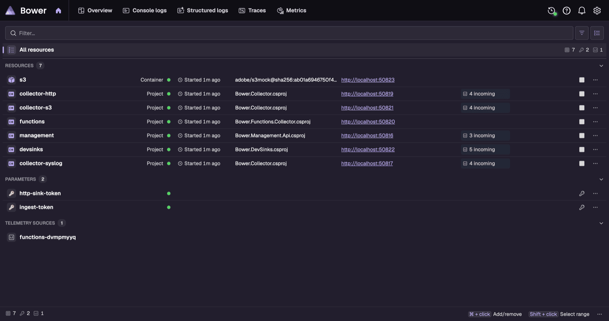
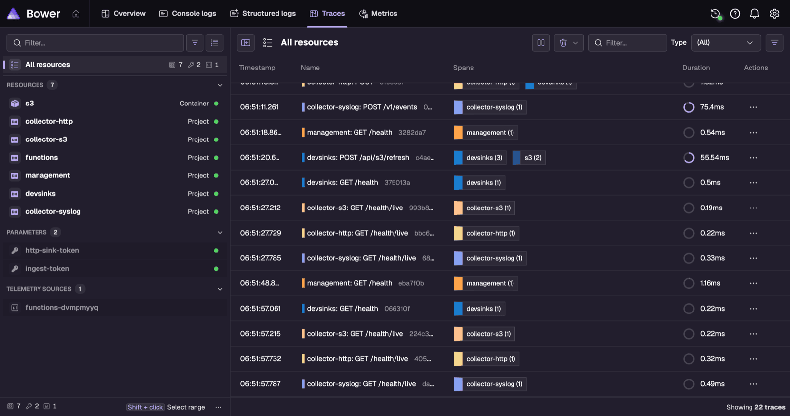

# Local development with Aspire

`src/Bower.AppHost` is an [Aspire](https://aspire.dev) AppHost that starts a working Bower
pipeline on your machine with one command: collectors, the management API, the Azure
Functions collector and local stand-in destinations, all visible in the Aspire dashboard
(resources, console logs, structured logs, traces and metrics).

It is a **local development and integration-test harness only**. It is never published,
packaged or deployed. Production stays on the existing paths: `deploy/docker` (Compose),
`deploy/bicep`, `deploy/azure-function`, `deploy/azure-webapp` and the native packages.



## What it runs

| Resource | What it is | Exercises |
|---|---|---|
| `collector-s3` | `Bower.Collector`, `BOWER_OUTPUT=s3` | `Bower.Output.S3` against the `s3` emulator |
| `collector-http` | `Bower.Collector`, `BOWER_OUTPUT=http`, `BOWER_HTTP_FORMAT=ndjson` | `Bower.Output.Http` against `devsinks` (`/ndjson`, bearer token, loopback HTTP) |
| `collector-syslog` | `Bower.Collector`, `BOWER_OUTPUT=ama-syslog` (Linux and macOS only) | `Bower.Output.AmaSyslog` against a Unix datagram socket bound by `devsinks` in place of rsyslog and Azure Monitor Agent |
| `functions` | `Bower.Functions.Collector` under Azure Functions Core Tools, `BOWER_DEVELOPMENT_AUTH=true` | Function host start-up, `/health`, `/v1/status`, request validation and policy |
| `management` | `Bower.Management.Api`, `BOWER_AUTH_MODE=development` | Fleet API and its health route |
| `s3` | `adobe/s3mock` 5.2.3 container, pinned by digest | S3-compatible bucket `bower-aspire` |
| `devsinks` | `tools/Bower.DevSinks` | NDJSON endpoint, syslog socket and a read-only view of what each destination received |

Each collector has its own queue under `artifacts/aspire/<resource>/`, an ingest token
generated on first run and stored in the AppHost user secrets (parameter `ingest-token`),
and exact producer scopes for the canary event only (`BOWER_PRODUCER_SCOPES_JSON`). No
collector uses `BOWER_SINGLE_TRUST_DOMAIN` or unauthenticated ingest.

`Bower.Jobs` is not a resource: it is the in-process scheduler library each host already
runs, not a separate process.

### What cannot be emulated

- **Azure Logs Ingestion** (`BOWER_OUTPUT=azure-logs-ingestion`, and the Functions
  collector's only output). There is no Microsoft emulator; it needs a real data collection
  endpoint, rule and Entra token. The `functions` resource points at the unreachable
  placeholder `https://logs-ingestion.invalid`, so `/v1/events` answers `503` ("Destination
  did not accept the event") after policy and redaction succeed. Test real delivery with
  [the Azure Functions guide](../deployment/azure-function.md) or the AWS validation lab.
- **Azure Monitor Agent** behind `ama-syslog` and `ama-spool`: the harness proves Bower
  wrote a correct frame, not that AMA forwarded it.
- **Entra authentication** for the management API and the Functions collector: both run in
  their explicit, Development-only bypass modes, which they refuse outside Development.
- **Windows Event Log** and other OS sources are not wired here.

The Functions host needs no storage (HTTP triggers only), so no Azurite container runs.

Nothing here proves Sentinel delivery. Canary output proves local receipt, policy
acceptance and delivery to a stand-in.

## Prerequisites

- .NET SDK `11.0.100` (pinned in `global.json`; Aspire 17 supports it with
  `rollForward: disable`).
- A container runtime. On a workstation, name the Docker context:
  `export DOCKER_CONTEXT=orbstack` (or `desktop-linux`).
- [Azure Functions Core Tools](https://learn.microsoft.com/azure/azure-functions/functions-run-local)
  v4 (`func`) for the `functions` resource.
- Optional: the [Aspire CLI](https://aspire.dev/get-started/install-cli/) (`aspire`).
  The first build of the AppHost fetches the matching CLI bundle (orchestrator and
  dashboard, about 170 MB) from nuget.org.

If `dotnet` lives in `~/.dotnet`, export `DOTNET_ROOT=$HOME/.dotnet` so the AppHost and
the services find the .NET 11 runtime.

## Run it

```bash
export DOCKER_CONTEXT=orbstack
aspire run --apphost src/Bower.AppHost -lp http
# or, without the Aspire CLI:
dotnet run --project src/Bower.AppHost --launch-profile http
```

The dashboard opens at `http://localhost:15319` (the login URL with its token is printed
on start-up). The `http` profile serves the dashboard over plain HTTP on loopback, so no
development certificate has to be trusted. The `aspire run` start-up warning about
untrusted developer certificates is expected with this profile.

## Send an event through

Each collector has a **Send canary** command (resource menu `…` in the dashboard, or the
CLI). It posts one synthetic authentication failure that `policies/default` accepts:

```bash
aspire resource collector-s3 send-canary
aspire resource collector-http send-canary
aspire resource collector-syslog send-canary
aspire resource devsinks read-s3        # pull the bucket's NDJSON objects into the view
```

Then check what each destination received (the `devsinks` URL is on the resources page):

```bash
curl -s http://localhost:<devsinks-port>/api/summary
# {"received":{"http":1,"syslog":1,"s3":1}}
curl -s http://localhost:<devsinks-port>/api/s3   # the delivered, redacted envelopes
```

You can also send your own events with the CLI. Read the token from the dashboard
(`ingest-token` parameter) and use the collector's port:

```bash
BOWER_INGEST_TOKEN=<ingest-token> dotnet run --project src/Bower.Cli -- \
  test emit --endpoint http://localhost:<collector-port>
```

`bower test emit` uses application `BowerCanary`, which the harness's producer scopes do
not grant, so it returns `403`. That is the default-deny behaviour working; use the
**Send canary** command or edit `CanaryEvent.ProducerScopesJson` for other identities.



## Telemetry

The hosts call `AddBowerServiceDefaults()` from `src/Bower.ServiceDefaults`. It registers
OpenTelemetry logs, metrics and traces with the OTLP exporter **only when
`OTEL_EXPORTER_OTLP_ENDPOINT` is set**, which Aspire sets for every resource and no shipped
deployment sets. Without it, nothing is registered and production behaviour is unchanged
(`ServiceDefaultsTests` pins this). Exported data is framework metadata (routes, status
codes, runtime and HTTP client metrics, log messages without scopes), never request or
response bodies, headers or query strings.

Generic HTTP resilience and service discovery are **not** applied to Bower's clients:
Bower retries through its durable queue, and the management client's single-use enrolment
token must not be retried by a generic handler. `AddBowerHttpClientDefaults()` exists for
a named client that explicitly opts in; no Bower client does today.

## Integration test

`tests/Bower.AppHost.Tests` boots the AppHost with `Aspire.Hosting.Testing` and checks a
canary reaches the S3 emulator, the NDJSON endpoint and the syslog socket. It needs a
container runtime and the Functions Core Tools, so it is skipped unless you opt in:

```bash
DOCKER_CONTEXT=orbstack BOWER_ASPIRE_TESTS=1 \
  dotnet test --project tests/Bower.AppHost.Tests
```

It uses a temporary state directory and its own tokens, so it can run beside a dashboard
session. CI builds the project; the test itself is skipped there. It takes about 30 seconds
once images are pulled.

## Clean up

Stop with `Ctrl+C` (or `aspire stop`). Containers are removed when the AppHost stops.
Queues and the management database persist in `artifacts/aspire/` (git-ignored); delete
that directory for a fresh start.
