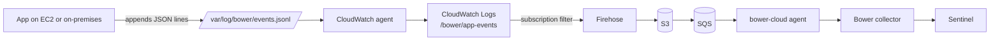

# Quick start: AWS with the CloudWatch agent

Use this when your servers already run the Amazon CloudWatch agent. Each server writes Bower
security events to a local file, the agent ships that file to CloudWatch Logs, and one Bower
deployment in the account forwards the events to Microsoft Sentinel. You don't install Bower
on every server.



The forwarding half (subscription filter, Firehose, S3, SQS and the `bower-cloud` agent) is
the existing [AWS security signal](../deployment/aws.md) stack. This page covers the part on
each server.

## Before you begin

- A Bower collector delivering to Sentinel, and the `bower-cloud` agent able to reach it.
  See [AWS security signal: run the agent](../deployment/aws.md#run-the-agent).
- The CloudWatch agent installed on each server, with an instance profile (EC2) or
  credentials profile (on-premises) that allows `logs:CreateLogStream` and
  `logs:PutLogEvents` on the log group. AWS's `CloudWatchAgentServerPolicy` covers this.

## 1. Write events to a file

Each line is one complete Bower event envelope: UTF-8 JSON, with no line breaks inside it,
written with a single append. The minimum is:

```json
{"schemaVersion":"1.0.0","eventId":"7f9c2b1e-5d4a-4c3b-9a8e-1f2d3c4b5a69","timeGenerated":"2026-11-10T01:02:03.456Z","eventCategory":"authentication","eventType":"authentication_failure","eventAction":"authentication.login","eventResult":"failure","eventSeverity":"medium","application":{"name":"orders-api","environment":"production"},"actor":{"type":"human","username":"alice@example.com"},"source":{"ipAddress":"203.0.113.24"}}
```

- `eventId` must be unique per event and stay the same if the line is written again.
- Only lines that contain `schemaVersion` leave CloudWatch Logs, so ordinary application
  logging can share the file, but a separate file is easier to reason about.
- To build events in an application, use the [framework helpers](../developer-integration/asvs-logging-frameworks.md)
  and append the result instead of posting it. To try the path, append a test event with
  [`examples/cloud-agents/emit_event.py`](https://github.com/jusso-dev/Bower/blob/main/examples/cloud-agents/emit_event.py):

```bash
sudo install -d -m 0750 -o root -g adm /var/log/bower
sudo python3 examples/cloud-agents/emit_event.py /var/log/bower/events.jsonl
```

Rotate the file with logrotate
([`logrotate-bower-events`](https://github.com/jusso-dev/Bower/blob/main/examples/cloud-agents/aws/logrotate-bower-events)
goes in `/etc/logrotate.d/`). The agent finishes a renamed file, then follows the new one.

!!! warning "Events are stored before Bower redacts them"
    In this path CloudWatch Logs and the S3 bucket hold the event as the server wrote it.
    Bower's privacy profile runs later, in the collector. Don't write passwords, tokens or
    session identifiers into the file; the framework helpers already drop secret-named fields.
    Keep the log group and bucket retention short (the stack's `AppLogRetentionDays` sets the
    bucket expiry).

## 2. Configure the CloudWatch agent

Create the log group once, with a short retention:

```bash
aws logs create-log-group --log-group-name /bower/app-events
aws logs put-retention-policy --log-group-name /bower/app-events --retention-in-days 7
```

Add the Bower file to the agent configuration. If the agent already has a configuration,
merge this `collect_list` entry into it rather than replacing the file:

```json
{
  "logs": {
    "logs_collected": {
      "files": {
        "collect_list": [
          {
            "file_path": "/var/log/bower/events.jsonl",
            "log_group_name": "/bower/app-events",
            "log_stream_name": "{instance_id}",
            "encoding": "utf-8",
            "filters": [
              {
                "type": "include",
                "expression": "\"schemaVersion\""
              }
            ]
          }
        ]
      }
    }
  }
}
```

Linux ([`amazon-cloudwatch-agent.json`](https://github.com/jusso-dev/Bower/blob/main/examples/cloud-agents/aws/amazon-cloudwatch-agent.json)):

```bash
sudo cp examples/cloud-agents/aws/amazon-cloudwatch-agent.json \
  /opt/aws/amazon-cloudwatch-agent/etc/bower-events.json
sudo /opt/aws/amazon-cloudwatch-agent/bin/amazon-cloudwatch-agent-ctl \
  -a append-config -m ec2 -s -c file:/opt/aws/amazon-cloudwatch-agent/etc/bower-events.json
```

Windows ([`amazon-cloudwatch-agent.windows.json`](https://github.com/jusso-dev/Bower/blob/main/examples/cloud-agents/aws/amazon-cloudwatch-agent.windows.json),
file `C:\ProgramData\BowerEvents\events.jsonl`):

```powershell
& "C:\Program Files\Amazon\AmazonCloudWatchAgent\amazon-cloudwatch-agent-ctl.ps1" `
  -a append-config -m ec2 -s -c file:C:\ProgramData\BowerEvents\bower-events.json
```

Use `-m onPremise` on servers outside EC2. `append-config` keeps the agent's existing
sources; `fetch-config` would replace them.

## 3. Forward the log group to Bower

Deploy (or update) the AWS stack with the log group name. It adds the subscription filter
that only sends lines containing `schemaVersion`:

```bash
aws cloudformation deploy --region ap-southeast-2 \
  --template-file deploy/aws/bower-aws-security.yaml \
  --stack-name bower-aws-security \
  --capabilities CAPABILITY_IAM \
  --parameter-overrides AppLogBucketName=acme-bower-app-logs AppLogGroupName=/bower/app-events
```

The stack takes one log group. To collect from several applications, point their agents at
the same group with different `log_stream_name` values.

## 4. Check it

1. On the server: `tail -1 /var/log/bower/events.jsonl` shows the event.
2. In CloudWatch Logs: the event appears in `/bower/app-events`.
3. On the collector: `bower tap --stage decided` shows it once Firehose has delivered (up to
   about a minute, the stream's buffer interval) and the agent has read the queue.
4. In Sentinel: `BowerSecurity_CL | where EventId == "<your eventId>"`.

If step 2 works and step 3 doesn't, check the SQS dead-letter queue and the agent's log;
see [AWS security signal](../deployment/aws.md#delivery-guarantees).
