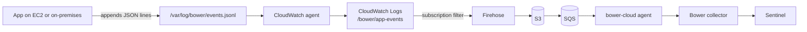

# Quick start: AWS with the CloudWatch agent

Use this when your servers already run the Amazon CloudWatch agent. Each server writes Bower
security events to a local file, the agent ships that file to CloudWatch Logs, and one Bower
deployment in the account forwards the events to Microsoft Sentinel. You don't install Bower
on every server.



The forwarding half (subscription filter, Firehose, S3, SQS and the `bower-cloud` agent) is
the existing [AWS security signal](../deployment/aws.md) stack. This page covers the part on
each server.

## Before you begin

- A Bower collector delivering to Sentinel, and the `bower-cloud` agent able to reach it.
  See [AWS security signal: run the agent](../deployment/aws.md#run-the-agent).
- The CloudWatch agent installed on each server, with an instance profile (EC2) or
  credentials profile (on-premises) that can write to the log group. AWS's
  `CloudWatchAgentServerPolicy` works, but it allows writing to any log group; the
  [least-privilege policy](#least-privilege-policy-for-the-agent) below limits the agent to
  `/bower/app-events`.

Each block below says where it runs: **on each server**, **on an admin workstation** (with
AWS CLI credentials for the account) or **on the `bower-cloud` host**.

### Get the files

Download the examples from the Bower release you deploy, not from `main`, so the files match
the collector and agent you run. On each server:

```bash
BOWER_REF=vX.Y.Z   # the Bower release tag you deploy
base="https://raw.githubusercontent.com/jusso-dev/Bower/$BOWER_REF/examples/cloud-agents"
curl -fsSL "$base/emit_event.py" -o /tmp/emit_event.py
curl -fsSL "$base/aws/amazon-cloudwatch-agent.json" -o /tmp/bower-events.json
curl -fsSL "$base/aws/logrotate-bower-events" -o /tmp/logrotate-bower-events
```

On the admin workstation you also need the stack template:

```bash
curl -fsSLO "https://raw.githubusercontent.com/jusso-dev/Bower/$BOWER_REF/deploy/aws/bower-aws-security.yaml"
```

## 1. Write events to a file

Each line is one complete Bower event envelope: UTF-8 JSON, with no line breaks inside it,
written with a single append. The minimum is:

```json
{"schemaVersion":"1.0.0","eventId":"7f9c2b1e-5d4a-4c3b-9a8e-1f2d3c4b5a69","timeGenerated":"2026-11-10T01:02:03.456Z","eventCategory":"authentication","eventType":"authentication_failure","eventAction":"authentication.login","eventResult":"failure","eventSeverity":"medium","application":{"name":"orders-api","environment":"production"},"actor":{"type":"human","username":"alice@example.com"},"source":{"ipAddress":"203.0.113.24"}}
```

- `eventId` must be unique per event and stay the same if the line is written again.
- Write each line with one `write` call on a file opened for append (`O_APPEND`). On a local
  Linux file system, writers then never interleave inside a line, whatever its length. A
  buffered writer (a default `print` to a file, most logging handlers) can split a line, and
  NFS doesn't give the same guarantee.
- A short write (for example a full disk) leaves a line with no line break, and the next
  event is glued to it: both are then invalid and the forwarder drops them. Before writing,
  check whether the file ends with a line break and start with one if it doesn't, as
  `emit_event.py` does. That limits the damage to the fragment.
- Keep each line well under 1 MB. CloudWatch Logs takes log events of up to 1 MB
  ([CloudWatch Logs quotas](https://docs.aws.amazon.com/AmazonCloudWatch/latest/logs/cloudwatch_limits_cwl.html),
  "Event size"), and the forwarder drops any line over 1 MiB (1,048,576 bytes). AWS doesn't
  document what the CloudWatch agent does with a longer line; whether it cuts it short or
  drops it, the event never reaches Sentinel. A security event of a few KB is normal.
- Only lines that contain `schemaVersion` leave CloudWatch Logs, so ordinary application
  logging can share the file, but a separate file is easier to reason about.
- To build events in an application, use the [framework helpers](../developer-integration/asvs-logging-frameworks.md)
  and append the result instead of posting it.

Give the application a group that can write the file, and keep everyone else out. On each
server, replacing `orders-api` with the account your application runs as:

```bash
sudo groupadd --system bower-events
sudo usermod -a -G bower-events orders-api
sudo install -d -m 2770 -o root -g bower-events /var/log/bower
# touch never truncates, so this is safe to run again on a file that already holds events.
sudo touch /var/log/bower/events.jsonl
sudo chown root:bower-events /var/log/bower/events.jsonl
sudo chmod 0660 /var/log/bower/events.jsonl
```

The setgid directory keeps new files in the `bower-events` group. The CloudWatch agent runs
as root by default and can read the file. If your agent configuration sets `run_as_user`
(for example `cwagent`), add that account to `bower-events` too. A running process keeps the
groups it started with, so restart the application, and the agent if you added its account
(`sudo systemctl restart amazon-cloudwatch-agent`).

### Rotate the file

Install the logrotate file
([`logrotate-bower-events`](https://github.com/jusso-dev/Bower/blob/main/examples/cloud-agents/aws/logrotate-bower-events)):

```bash
sudo install -m 0644 -o root -g root /tmp/logrotate-bower-events /etc/logrotate.d/bower-events
sudo logrotate -d /etc/logrotate.d/bower-events   # dry run: shows what it would do
```

It renames the file to `events.jsonl.1` and creates a new `events.jsonl` with the same owner,
group and mode. Its `su root bower-events` line is required: without it logrotate refuses to
rotate a file in a group-writable directory ("parent directory has insecure permissions") and
the file grows without limit.

What your application must do at rotation depends on how it writes:

- **Opens the file for each event** (as `emit_event.py` does): nothing. The next event goes to
  the new file.
- **Keeps the file open**: it goes on appending to the renamed `events.jsonl.1` until it
  reopens the path. Make it reopen on a signal and send that signal from a `postrotate` block
  in the logrotate file (the example shows where). Don't switch to `copytruncate`: lines
  written between the copy and the truncate are lost.

On the agent side, AWS documents that a rotation which changes the file's inode (rename and
create, as here) makes the agent read the new file from the beginning, and that the agent
keeps its read position in a state file so a restart doesn't send lines again
([Log duplicate prevention and the state file](https://docs.aws.amazon.com/AmazonCloudWatch/latest/monitoring/troubleshooting-CloudWatch-Agent.html#troubleshooting-CloudWatch-Agent-log-duplicate-state-file)).

Measured with a live agent (CloudWatch agent 1.300073.2 on Amazon Linux 2023, 11-11-2026):

- The new file is picked up and read from the start: 20 of 20 lines written after rotation
  arrived, none twice.
- **Lines written to the renamed `events.jsonl.1` after the rename are never shipped** (0 of
  10). The agent logs "Stopping tail as file no longer exists" for the path the moment it is
  renamed and only follows the path from then on.
- **The last lines before a rotation can be lost too.** With 10 lines written and the file
  rotated straight away, 8 arrived. The agent had not read the last 2 when it stopped
  following the renamed file. `delaycompress` keeps that file on disk, but the agent never
  goes back to it. With the same 10 lines and 30 seconds of quiet before the rotation, 10 of
  10 arrived.

So any line in the renamed file that the agent hasn't read yet is lost, with no error. To keep
the window small:

- Writers that keep the file open must reopen on rotation (the `postrotate` signal above),
  as fast as they can.
- Rotate when writes are quiet, and not more often than you need (`daily` with `maxsize`, as
  in the example).
- Watch for the gap. The rows that arrive in Sentinel carry `Origin.logStream`, and
  [`delivery-sequence-gaps.kql`](https://github.com/jusso-dev/Bower/blob/main/deploy/sentinel/monitoring/queries/delivery-sequence-gaps.kql)
  covers losses after the collector. A loss here happens before Bower sees the line, so only a
  count kept by the application can show it.
- If a line is ever shipped twice, the collector deduplicates it by `eventId`.

`examples/cloud-agents/aws/test_logrotate.sh` checks the logrotate side in a container
(Ubuntu 24.04 and Amazon Linux 2023), and CI runs it.

### Several applications on one server

Give each application its own group and directory. Members of one shared group can delete,
replace or append to each other's files, so a compromised application could write events in
another one's name. The sticky bit (`3770`) stops deleting and replacing, but not appending,
so it isn't enough. `test_logrotate.sh` checks both layouts. On each server:

```bash
sudo install -d -m 0755 -o root -g root /var/log/bower
for app in orders-api billing-api; do
  sudo groupadd --system "bower-$app"
  sudo usermod -a -G "bower-$app" "$app"
  sudo install -d -m 2770 -o root -g "bower-$app" "/var/log/bower/$app"
  sudo touch "/var/log/bower/$app/events.jsonl"
  sudo chown "root:bower-$app" "/var/log/bower/$app/events.jsonl"
  sudo chmod 0660 "/var/log/bower/$app/events.jsonl"
  sed -e "s|/var/log/bower/events.jsonl|/var/log/bower/$app/events.jsonl|" \
      -e "s|bower-events|bower-$app|g" /tmp/logrotate-bower-events |
    sudo tee "/etc/logrotate.d/bower-$app" >/dev/null
done
```

Then add one `collect_list` entry per file in step 2.

!!! warning "Events are stored before Bower redacts them"
    In this path CloudWatch Logs and the S3 bucket hold the event as the server wrote it.
    Bower's privacy profile runs later, in the collector. Don't write passwords, tokens or
    session identifiers into the file; the framework helpers already drop secret-named fields.
    Keep the log group and bucket retention short (the stack's `AppLogRetentionDays` sets the
    bucket expiry), and limit who can read the copies:

    - Grant `logs:GetLogEvents`, `logs:FilterLogEvents`, `logs:StartQuery` and
      `logs:StartLiveTail` on `/bower/app-events` only to the people who investigate these
      events.
    - Grant `s3:GetObject` on the app log bucket only to the `bower-cloud` agent (the stack's
      `ConsumerPolicy`) and the same investigators. The stack encrypts the bucket with
      S3-managed keys (`AES256`), so anyone with `s3:GetObject` can read the objects.
    - Consider a KMS key for the log group
      ([Encrypt log data in CloudWatch Logs using AWS KMS](https://docs.aws.amazon.com/AmazonCloudWatch/latest/logs/encrypt-log-data-kms.html)),
      so reading the events also needs `kms:Decrypt`.

## 2. Configure the CloudWatch agent

On the admin workstation, create the log group once, with a short retention, in the Region
where you deploy the Bower stack in step 3 (Sydney here):

```bash
export AWS_REGION=ap-southeast-2
aws logs create-log-group --region "$AWS_REGION" --log-group-name /bower/app-events
aws logs put-retention-policy --region "$AWS_REGION" --log-group-name /bower/app-events --retention-in-days 7
```

If the group already exists, `create-log-group` fails with `ResourceAlreadyExistsException`;
that's harmless, and `put-retention-policy` still sets the retention.

The agent on each server must send to the same Region. On EC2 it uses the instance's Region
by default. On a server outside AWS it uses the `region` in the `AmazonCloudWatchAgent`
profile of its AWS config file.

Add the Bower file to the agent configuration. If the agent already has a configuration,
merge this `collect_list` entry into it rather than replacing the file:

```json
{
  "logs": {
    "logs_collected": {
      "files": {
        "collect_list": [
          {
            "file_path": "/var/log/bower/events.jsonl",
            "log_group_name": "/bower/app-events",
            "log_stream_name": "{instance_id}",
            "encoding": "utf-8",
            "filters": [
              {
                "type": "include",
                "expression": "\"schemaVersion\""
              }
            ]
          }
        ]
      }
    }
  }
}
```

- **Stream name.** `{instance_id}` is the EC2 instance ID, so each instance writes its own
  stream. AWS doesn't document what it becomes on a server outside EC2, so on-premises set
  `"log_stream_name": "{local_hostname}"` (the host name from the server's own network
  configuration; `{hostname}` comes from EC2 metadata), and make sure host names are unique,
  or two servers share one stream
  ([agent configuration file reference](https://docs.aws.amazon.com/AmazonCloudWatch/latest/monitoring/CloudWatch-Agent-Configuration-File-Details.html)).
- **Several applications.** Add one entry per file, each with its own stream name:

    ```json
    {
      "file_path": "/var/log/bower/billing-api/events.jsonl",
      "log_group_name": "/bower/app-events",
      "log_stream_name": "{instance_id}/billing-api",
      "encoding": "utf-8",
      "filters": [{ "type": "include", "expression": "\"schemaVersion\"" }]
    }
    ```

- **Event time.** Without `timestamp_format` the agent records the time it read the line
  ("If you omit this field, the current time is used"), so the CloudWatch console shows read
  time. Bower and Sentinel use `timeGenerated` from the event itself.

Apply it on each server with `append-config`, which keeps the agent's existing sources
(`fetch-config` would replace them). Use `-m ec2` on EC2 and `-m onPremise` on servers outside
EC2.

Linux ([`amazon-cloudwatch-agent.json`](https://github.com/jusso-dev/Bower/blob/main/examples/cloud-agents/aws/amazon-cloudwatch-agent.json)):

```bash
sudo install -m 0644 /tmp/bower-events.json /opt/aws/amazon-cloudwatch-agent/etc/bower-events.json
sudo /opt/aws/amazon-cloudwatch-agent/bin/amazon-cloudwatch-agent-ctl \
  -a append-config -m ec2 -s -c file:/opt/aws/amazon-cloudwatch-agent/etc/bower-events.json
```

### Windows

!!! note "How these steps are tested"
    CI runs the commands in this section as written on Windows Server 2025
    ([`test_windows_event_folder.ps1`](https://github.com/jusso-dev/Bower/blob/main/examples/cloud-agents/aws/test_windows_event_folder.ps1)).
    It signs in as a second standard user, who is refused both reading the file and creating
    one in the folder, and it runs the rotation task as SYSTEM. It doesn't run the
    CloudWatch agent itself. Run the permission check below on your own servers too.

The event file is `C:\ProgramData\BowerEvents\events.jsonl`. A folder made under
`C:\ProgramData` inherits an ACL that lets every local user create files (the Bower installer
breaks inheritance on its own folder for the same reason), so lock the folder down before the
application writes to it. Without that, any local user could read the unredacted events, or
create `events.jsonl` first and own it.

In an elevated PowerShell on each server, replacing the application account (a domain
account, `NT SERVICE\<service>` or `IIS AppPool\<pool>`):

```powershell
$dir = 'C:\ProgramData\BowerEvents'
$app = 'CONTOSO\svc-orders'   # the account the application runs as
New-Item -ItemType Directory -Force -Path $dir | Out-Null
# Remove inherited entries, then grant SYSTEM (S-1-5-18) and Administrators (S-1-5-32-544)
# full control and the application Modify, for the folder and everything created in it.
icacls $dir /inheritance:r /grant:r '*S-1-5-18:(OI)(CI)F' '*S-1-5-32-544:(OI)(CI)F' "${app}:(OI)(CI)M"
# Create the file now, so no one else can create it first. It inherits the folder's entries.
if (-not (Test-Path "$dir\events.jsonl")) { New-Item -ItemType File -Path "$dir\events.jsonl" | Out-Null }
icacls $dir
```

The last command should list only `NT AUTHORITY\SYSTEM`, `BUILTIN\Administrators` and the
application account. If the folder already existed with explicit entries (for example a
grant to `Users`), they survive `/inheritance:r`: remove them with `icacls $dir /remove:g <name>`.

Then add the file to the agent (`amazon-cloudwatch-agent.windows.json`), with `-m ec2` on EC2
or `-m onPremise` outside EC2:

```powershell
$base = "https://raw.githubusercontent.com/jusso-dev/Bower/$env:BOWER_REF/examples/cloud-agents/aws"
Invoke-WebRequest "$base/amazon-cloudwatch-agent.windows.json" -OutFile "$dir\bower-events.json"
& "C:\Program Files\Amazon\AmazonCloudWatchAgent\amazon-cloudwatch-agent-ctl.ps1" `
  -a append-config -m ec2 -s -c "file:$dir\bower-events.json"
```

Set `$env:BOWER_REF` to the release tag first. The agent runs as Local System, so it can read
the file.

**Check the permissions** while signed in as a standard user who isn't the application
account. Both commands must fail with "Access to the path is denied":

```powershell
Get-Content C:\ProgramData\BowerEvents\events.jsonl
New-Item -ItemType File -Path C:\ProgramData\BowerEvents\other.jsonl
```

**Rotate the file.** Windows has no logrotate.
[`rotate-bower-events.ps1`](https://github.com/jusso-dev/Bower/blob/main/examples/cloud-agents/aws/rotate-bower-events.ps1)
renames `events.jsonl` to `events.jsonl.1` (keeping seven), and creates a new empty file,
which inherits the folder's entries. Run it daily as SYSTEM from a scheduled task. Keep the
script in a folder only administrators can write to, because SYSTEM runs it:

```powershell
$tool = 'C:\Program Files\BowerEvents'
New-Item -ItemType Directory -Force -Path $tool | Out-Null
Invoke-WebRequest "$base/rotate-bower-events.ps1" -OutFile "$tool\rotate-bower-events.ps1"
$action = New-ScheduledTaskAction -Execute 'powershell.exe' `
  -Argument "-NoProfile -File `"$tool\rotate-bower-events.ps1`""
$trigger = New-ScheduledTaskTrigger -Daily -At 00:05
Register-ScheduledTask -TaskName 'Bower event file rotation' -Action $action -Trigger $trigger `
  -User 'NT AUTHORITY\SYSTEM' -RunLevel Highest
```

The application must open the file for each event, or reopen it after rotation. If a process holds `events.jsonl` open without delete sharing, the rename
fails and the script stops without changing anything; it tries again the next day. If the
task history shows it failing every day, this approach doesn't suit your application, and
the file keeps growing until you rotate it another way. AWS doesn't document how the agent on
Windows follows a renamed file.

### Least-privilege policy for the agent

Attach this to the instance profile role (EC2) or the credentials the agent uses
(on-premises) instead of `CloudWatchAgentServerPolicy`, with your Region and account. It
covers the Bower file only; if the same agent ships other logs or metrics, keep what those
need. `CreateLogStream` and `PutLogEvents` act on the log stream, `DescribeLogStreams` on the
group
([actions, resources and condition keys for CloudWatch Logs](https://docs.aws.amazon.com/service-authorization/latest/reference/list_amazoncloudwatchlogs.html)).
Tested with a live agent (CloudWatch agent 1.300073.2, Amazon Linux 2023, 11-11-2026): with only
this policy on the instance role, the agent created the instance's stream and shipped every
event.

```json
{
  "Version": "2012-10-17",
  "Statement": [
    {
      "Sid": "FindBowerStreams",
      "Effect": "Allow",
      "Action": "logs:DescribeLogStreams",
      "Resource": "arn:aws:logs:ap-southeast-2:111122223333:log-group:/bower/app-events"
    },
    {
      "Sid": "WriteBowerEvents",
      "Effect": "Allow",
      "Action": ["logs:CreateLogStream", "logs:PutLogEvents"],
      "Resource": "arn:aws:logs:ap-southeast-2:111122223333:log-group:/bower/app-events:log-stream:*"
    }
  ]
}
```

## 3. Forward the log group to Bower

On the admin workstation, deploy (or update) the AWS stack with the log group name. It adds
the subscription filter that only sends lines containing `schemaVersion`:

```bash
aws cloudformation deploy --region "$AWS_REGION" \
  --template-file bower-aws-security.yaml \
  --stack-name bower-aws-security \
  --capabilities CAPABILITY_IAM \
  --parameter-overrides AppLogBucketName=acme-bower-app-logs AppLogGroupName=/bower/app-events
```

Then, on the `bower-cloud` host, allow the new bucket in the agent. It ignores S3
notifications from any bucket not listed in `BOWER_AWS_S3_BUCKETS` and deletes them as
unsupported, so without this the events reach the queue but never Sentinel. Set the complete
list (buckets already allowed, plus the new one) where Compose reads it, then recreate the
agent, from the directory where you deployed it:

```bash
# deploy/docker/compose.cloud.yaml reads BOWER_AWS_S3_BUCKETS from the environment or an .env file.
export BOWER_AWS_S3_BUCKETS=existing-bucket,acme-bower-app-logs
docker compose -f deploy/docker/compose.cloud.yaml up -d
docker compose -f deploy/docker/compose.cloud.yaml exec bower-cloud printenv BOWER_AWS_S3_BUCKETS
```

A plain `BOWER_AWS_S3_BUCKETS=...` line in your shell isn't passed to Compose unless it's
exported; an empty value would make the agent drop every app-log notification.

The stack takes one log group. To collect from several applications, point their agents at
the same group with different `log_stream_name` values, as in step 2.

### Trust boundary

The collector sees every event on this path as coming from one producer: the `bower-cloud`
agent's ingest token, so [producer scopes](../security/producer-scopes.md) can't tell one
server from another here. That means **any server or account that can write to the log group
can send events that claim any application identity**, and the collector accepts them. A
compromised low-value server, or any local account in its `bower-events` group, could write
events in the name of a different application. Policy and redaction still run on them.

What Bower does record is where each event came from. The agent passes on the log group and
stream of every line, and the row's `Origin` column holds them
(`Origin.kind == "cloudwatch-logs"`, `Origin.logGroup`, `Origin.logStream`). With the stream
named after the instance (the example's `{instance_id}`), each row names the server whose
stream it was written to. The application cannot set this. To turn it on, give the agent its
own entry in the collector's `BOWER_INGEST_TOKENS_FILE` and list that producer in
`BOWER_ORIGIN_PRODUCERS`, for example `BOWER_ORIGIN_PRODUCERS=bower-cloud`. Without it the
column stays empty. See [BowerSecurity_CL columns](../reference/sentinel-table.md#origin).

`Origin` names the stream, not the account that wrote to it, so it identifies the server only
as far as each server is limited to its own stream. To keep that blast radius small:

- Use **one log group, and one Bower stack, per trust level**, so servers you trust less
  can't write where your most important applications write.
- Limit what each server can write. The confirmed facts, from AWS's
  [actions, resources and condition keys for CloudWatch Logs](https://docs.aws.amazon.com/service-authorization/latest/reference/list_amazoncloudwatchlogs.html):
  `logs:CreateLogStream` and `logs:PutLogEvents` act on the log-stream resource
  (`arn:aws:logs:<region>:<account>:log-group:<group>:log-stream:<stream>`), and the only
  condition key CloudWatch Logs offers on log groups and streams is `aws:ResourceTag/${TagKey}`.
  So the limit goes in the policy's `Resource`. The simplest form that needs no further
  checking is one role per server or per group of equally trusted servers, each allowed only
  its own stream names, for example `...:log-stream:orders-api-*`, with the agent's
  `log_stream_name` set to match.
- **One shared role can't pin each instance to its own stream.** Tested live with one
  instance role (11-11-2026):
  - A policy naming the instance's own stream exactly
    (`...:log-stream:i-0abc123...`) allowed that stream and denied writes and stream creation
    for any other.
  - None of the policy variables that could make that one shared policy worked:
    `${ec2:InstanceID}` and `${ec2:SourceInstanceARN}` in the stream ARN, and an
    `aws:userid` condition against `${logs:LogStreamName}`, all denied even the instance's own
    stream.
  - `${aws:userid}` resolves to `<role-id>:<instance-id>`, and a stream name can't contain `:`
    (CloudWatch refused it as an invalid parameter).

  So the limit has to be per role: one role, or one policy, per server or per group of equally
  trusted servers, each naming its own streams. Treat every server that shares a role as able
  to write any stream that role allows. AWS documents the two values
  ([IAM policy variables](https://docs.aws.amazon.com/IAM/latest/UserGuide/reference_policies_variables.html#principaltable),
  [condition keys](https://docs.aws.amazon.com/IAM/latest/UserGuide/reference_policies_condition-keys.html)).

## Limits

- **Firehose buffer.** The stack's Firehose stream writes an S3 object every 60 seconds or
  5 MB, whichever comes first (`BufferingHints` in `bower-aws-security.yaml`).
- **One S3 object per SQS message.** The `bower-cloud` agent refuses an object over 32 MB
  (`BOWER_AWS_S3_MAX_OBJECT_MB`), over 64 MiB once decompressed, or holding more than 50,000
  Bower events. It treats such a message as malformed: it releases it at once, and after
  `MaxReceiveCount` deliveries (10 by default) SQS moves it to the dead-letter queue, **with
  every event in that object**. At a 5 MB buffer this needs an unusual burst, but a server
  that writes a flood of events can cause it. Fix the cause, then use SQS dead-letter queue
  redrive; the objects stay in S3 for `AppLogRetentionDays`.
- **Dropped lines.** A log event that isn't a usable Bower envelope (not JSON, over 1 MiB, or
  missing `schemaVersion`, `eventId` or `eventType`) is dropped. The subscription filter
  passes it because it contains `schemaVersion`. The agent counts these drops in its pass
  summary (`... log line(s) skipped as not a Bower envelope.`) and logs a warning per object
  with the bucket, key and count, never the content:

    ```text
    S3 object acme-bower-app-logs/bower/2026/11/10/01/...: 1 of 40 log event(s) skipped as not a usable Bower envelope (not JSON, over 1 MiB, or missing schemaVersion, eventId or eventType); those events are not forwarded.
    ```

    Look on the server for a line that's too long, was written in two pieces or follows a
    partial line.

## 4. Check it

Send the test event only now, once the agent and the forwarding are in place, so the check
doesn't depend on whether the agent reads a file it has just been given from the start or
from the end. On a server (`--application` and `--environment` set the event's
`application`, so you can tell servers apart):

```bash
sudo -u orders-api python3 /tmp/emit_event.py /var/log/bower/events.jsonl \
  --application orders-api --environment production
```

On Windows, run `python emit_event.py C:\ProgramData\BowerEvents\events.jsonl` as the
application account (for example with `runas /user:CONTOSO\svc-orders`). It prints the
`eventId`. Then:

1. On the server: `sudo tail -1 /var/log/bower/events.jsonl` shows the event.
2. In CloudWatch Logs: the event appears in `/bower/app-events`.
3. On the collector: `bower tap --stage decided` shows it once Firehose has delivered (up to
   about a minute, the stream's buffer interval) and the agent has read the queue.
4. In Sentinel: `BowerSecurity_CL | where EventId == "<your eventId>"`.

If step 2 works and step 3 doesn't, check the SQS dead-letter queue and the agent's log;
see [AWS security signal](../deployment/aws.md#delivery-guarantees). Search the log for:

- `S3 notification for bucket {Bucket} ignored; add it to BOWER_AWS_S3_BUCKETS to read it.`
  (warning): the bucket isn't in `BOWER_AWS_S3_BUCKETS`. The agent deleted the notification,
  so fixing the list doesn't bring those events back by itself. The objects are still in the
  bucket under `bower/` for `AppLogRetentionDays`. To replay them, after fixing the list,
  copy each object onto itself so S3 sends a new notification (this is a write to the bucket;
  run it with an administrator's credentials, not the agent's):

    ```bash
    aws s3 cp --recursive "s3://acme-bower-app-logs/bower/2026/11/10/" "s3://acme-bower-app-logs/bower/2026/11/10/" \
      --metadata-directive REPLACE --metadata replayed=true
    ```

    The collector deduplicates by `eventId`, so replaying an object twice is harmless.

- `log event(s) skipped as not a usable Bower envelope` (warning): see [Limits](#limits).
