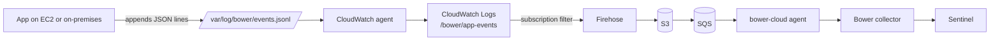

# Quick start: AWS with the CloudWatch agent

Use this when your servers already run the Amazon CloudWatch agent. Each server writes Bower
security events to a local file, the agent ships that file to CloudWatch Logs, and one Bower
deployment in the account forwards the events to Microsoft Sentinel. You don't install Bower
on every server.



The forwarding half (subscription filter, Firehose, S3, SQS and the `bower-cloud` agent) is
the existing [AWS security signal](../deployment/aws.md) stack. This page covers the part on
each server.

## Before you begin

- A Bower collector delivering to Sentinel, and the `bower-cloud` agent able to reach it.
  See [AWS security signal: run the agent](../deployment/aws.md#run-the-agent).
- The CloudWatch agent installed on each server, with an instance profile (EC2) or
  credentials profile (on-premises) that allows `logs:CreateLogStream` and
  `logs:PutLogEvents` on the log group. AWS's `CloudWatchAgentServerPolicy` covers this.

## 1. Write events to a file

Each line is one complete Bower event envelope: UTF-8 JSON, with no line breaks inside it,
written with a single append. The minimum is:

```json
{"schemaVersion":"1.0.0","eventId":"7f9c2b1e-5d4a-4c3b-9a8e-1f2d3c4b5a69","timeGenerated":"2026-11-10T01:02:03.456Z","eventCategory":"authentication","eventType":"authentication_failure","eventAction":"authentication.login","eventResult":"failure","eventSeverity":"medium","application":{"name":"orders-api","environment":"production"},"actor":{"type":"human","username":"alice@example.com"},"source":{"ipAddress":"203.0.113.24"}}
```

- `eventId` must be unique per event and stay the same if the line is written again.
- Only lines that contain `schemaVersion` leave CloudWatch Logs, so ordinary application
  logging can share the file, but a separate file is easier to reason about.
- To build events in an application, use the [framework helpers](../developer-integration/asvs-logging-frameworks.md)
  and append the result instead of posting it. To try the path, append a test event with
  [`examples/cloud-agents/emit_event.py`](https://github.com/jusso-dev/Bower/blob/main/examples/cloud-agents/emit_event.py):

Give the application a group that can write the file, and keep everyone else out. Replace
`orders-api` with the account your application runs as:

```bash
sudo groupadd --system bower-events
sudo usermod -a -G bower-events orders-api
sudo install -d -m 2770 -o root -g bower-events /var/log/bower
sudo install -m 0660 -o root -g bower-events /dev/null /var/log/bower/events.jsonl
sudo -u orders-api python3 examples/cloud-agents/emit_event.py /var/log/bower/events.jsonl
```

The setgid directory keeps new files in the `bower-events` group. The CloudWatch agent runs
as root by default and can read the file. If your agent configuration sets `run_as_user`
(for example `cwagent`), add that account to `bower-events` too, and restart the application
so it picks up the new group.

Rotate the file with logrotate
([`logrotate-bower-events`](https://github.com/jusso-dev/Bower/blob/main/examples/cloud-agents/aws/logrotate-bower-events)
goes in `/etc/logrotate.d/`). It recreates the file with the same owner, group and mode. The
agent finishes a renamed file, then follows the new one.

!!! warning "Events are stored before Bower redacts them"
    In this path CloudWatch Logs and the S3 bucket hold the event as the server wrote it.
    Bower's privacy profile runs later, in the collector. Don't write passwords, tokens or
    session identifiers into the file; the framework helpers already drop secret-named fields.
    Keep the log group and bucket retention short (the stack's `AppLogRetentionDays` sets the
    bucket expiry).

## 2. Configure the CloudWatch agent

Create the log group once, with a short retention, in the Region where you deploy the
Bower stack in step 3 (Sydney here):

```bash
export AWS_REGION=ap-southeast-2
aws logs create-log-group --region "$AWS_REGION" --log-group-name /bower/app-events
aws logs put-retention-policy --region "$AWS_REGION" --log-group-name /bower/app-events --retention-in-days 7
```

The agent on each server must send to the same Region. On EC2 it uses the instance's Region
by default. On a server outside AWS it uses the `region` in the `AmazonCloudWatchAgent`
profile of its AWS config file.

Add the Bower file to the agent configuration. If the agent already has a configuration,
merge this `collect_list` entry into it rather than replacing the file:

```json
{
  "logs": {
    "logs_collected": {
      "files": {
        "collect_list": [
          {
            "file_path": "/var/log/bower/events.jsonl",
            "log_group_name": "/bower/app-events",
            "log_stream_name": "{instance_id}",
            "encoding": "utf-8",
            "filters": [
              {
                "type": "include",
                "expression": "\"schemaVersion\""
              }
            ]
          }
        ]
      }
    }
  }
}
```

Linux ([`amazon-cloudwatch-agent.json`](https://github.com/jusso-dev/Bower/blob/main/examples/cloud-agents/aws/amazon-cloudwatch-agent.json)):

```bash
sudo cp examples/cloud-agents/aws/amazon-cloudwatch-agent.json \
  /opt/aws/amazon-cloudwatch-agent/etc/bower-events.json
sudo /opt/aws/amazon-cloudwatch-agent/bin/amazon-cloudwatch-agent-ctl \
  -a append-config -m ec2 -s -c file:/opt/aws/amazon-cloudwatch-agent/etc/bower-events.json
```

Windows ([`amazon-cloudwatch-agent.windows.json`](https://github.com/jusso-dev/Bower/blob/main/examples/cloud-agents/aws/amazon-cloudwatch-agent.windows.json),
file `C:\ProgramData\BowerEvents\events.jsonl`):

```powershell
New-Item -ItemType Directory -Force -Path C:\ProgramData\BowerEvents | Out-Null
Copy-Item examples\cloud-agents\aws\amazon-cloudwatch-agent.windows.json `
  C:\ProgramData\BowerEvents\bower-events.json
& "C:\Program Files\Amazon\AmazonCloudWatchAgent\amazon-cloudwatch-agent-ctl.ps1" `
  -a append-config -m ec2 -s -c file:C:\ProgramData\BowerEvents\bower-events.json
```

Grant the application's account Modify on `C:\ProgramData\BowerEvents` so it can create and
append to `events.jsonl`. The agent runs as Local System and can read it.

Use `-m onPremise` on servers outside EC2. `append-config` keeps the agent's existing
sources; `fetch-config` would replace them.

## 3. Forward the log group to Bower

Deploy (or update) the AWS stack with the log group name. It adds the subscription filter
that only sends lines containing `schemaVersion`:

```bash
aws cloudformation deploy --region ap-southeast-2 \
  --template-file deploy/aws/bower-aws-security.yaml \
  --stack-name bower-aws-security \
  --capabilities CAPABILITY_IAM \
  --parameter-overrides AppLogBucketName=acme-bower-app-logs AppLogGroupName=/bower/app-events
```

Then allow the new bucket in the `bower-cloud` agent. It ignores S3 notifications from any
bucket not listed in `BOWER_AWS_S3_BUCKETS` and deletes them as unsupported, so without this
the events reach the queue but never Sentinel. Add the bucket to any already listed:

```bash
# in the environment of the bower-cloud agent (for example deploy/docker/compose.cloud.yaml)
BOWER_AWS_S3_BUCKETS=acme-bower-app-logs
docker compose -f deploy/docker/compose.cloud.yaml up -d   # recreate the agent with the new setting
```

The stack takes one log group. To collect from several applications, point their agents at
the same group with different `log_stream_name` values.

## 4. Check it

1. On the server: `tail -1 /var/log/bower/events.jsonl` shows the event.
2. In CloudWatch Logs: the event appears in `/bower/app-events`.
3. On the collector: `bower tap --stage decided` shows it once Firehose has delivered (up to
   about a minute, the stream's buffer interval) and the agent has read the queue.
4. In Sentinel: `BowerSecurity_CL | where EventId == "<your eventId>"`.

If step 2 works and step 3 doesn't, check the SQS dead-letter queue and the agent's log;
see [AWS security signal](../deployment/aws.md#delivery-guarantees).
