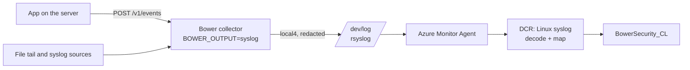

# Quick start: Azure with Azure Monitor Agent

Use this when your Linux servers already run Azure Monitor Agent (AMA): Azure VMs, scale sets,
or Azure Arc-enabled servers anywhere. On Linux, AMA collects syslog. Bower runs on each server,
selects and redacts the security events, then hands them to the local syslog daemon. AMA's
syslog collection carries them to the same `BowerSecurity_CL` table in Sentinel. Bower needs
no Azure credential on the server; AMA's managed identity does the upload.



Bower doesn't replace or change AMA. Keep AMA collecting whatever it already collects; this
adds one more data collection rule (DCR) for one syslog facility.

## Before you begin

- The Bower Sentinel resources from `deploy/bicep/main.bicep`, which create the
  `BowerSecurity_CL` table. See [Azure ingestion API](../deployment/logs-ingestion-api.md).
- AMA installed on the server, and rsyslog as its syslog daemon (the default on the
  distributions AMA supports).
- A free syslog facility for Bower. The default is `local4`; pick another `local0`–`local7`
  if something on the server already uses it.

## 1. Install Bower and send its output to syslog

Install the [deb or rpm package](../deployment/installers.md), then set the output in
`/etc/bower/bower.env`
([example](https://github.com/jusso-dev/Bower/blob/main/examples/cloud-agents/azure/bower.env)):

```bash
BOWER_OUTPUT=syslog
# Optional: the facility (20 is local4) and the largest message rsyslog accepts.
BOWER_SYSLOG_OUTPUT_FACILITY=20
BOWER_SYSLOG_OUTPUT_MAX_BYTES=8192
```

Restart the service (`sudo systemctl restart bower`). Each event goes to `/dev/log` as one
message tagged `bower`, with the redacted envelope base64-encoded after `bower-b64:`.
Encoding keeps the envelope intact: Azure Monitor removes semicolons from syslog messages during
ingestion, and syslog has no room for line breaks.

The packaged service already runs as the `bower` account, and every local account can write to
`/dev/log`, so no extra permission is needed.

## 2. Let rsyslog keep up

Security events can arrive in bursts. Check the two limits that can drop local syslog, and the
message size:

- **journald** (systemd servers): it rate-limits each service. Raise it with a drop-in
  ([`journald-bower.conf`](https://github.com/jusso-dev/Bower/blob/main/examples/cloud-agents/azure/journald-bower.conf)):

    ```ini
    # /etc/systemd/journald.conf.d/bower.conf
    [Journal]
    RateLimitIntervalSec=30s
    RateLimitBurst=50000
    ```

- **rsyslog**: its `imjournal` input allows 20,000 messages per 10 minutes by default
  (`Ratelimit.Burst` and `Ratelimit.Interval`). Raise them if your peak is higher.
- **Size**: rsyslog's default `MaxMessageSize` is 8 KiB. Bower never truncates: an event that
  doesn't fit is refused and dead-lettered with `payload-too-large`, and you can see it in
  `bower queue dead-letters`. If you raise `$MaxMessageSize` (at the top of `rsyslog.conf`,
  before any input), raise `BOWER_SYSLOG_OUTPUT_MAX_BYTES` to match.

Restart journald and rsyslog after changing them.

## 3. Create the collection rule

Deploy [`deploy/bicep/ama-syslog-dcr.bicep`](https://github.com/jusso-dev/Bower/blob/main/deploy/bicep/ama-syslog-dcr.bicep).
It collects the Bower facility at notice and above, keeps only messages that carry a Bower
envelope, decodes them and maps them onto the same columns as `main.bicep`, so rows from AMA
and rows from the Logs Ingestion API look the same. Other messages on that facility match no
row and aren't stored.

```bash
# Preview first; nothing is created until you run "create".
az deployment group what-if --resource-group rg-sentinel \
  --template-file deploy/bicep/ama-syslog-dcr.bicep \
  --parameters workspaceName=law-sentinel

az deployment group create --resource-group rg-sentinel \
  --template-file deploy/bicep/ama-syslog-dcr.bicep \
  --parameters workspaceName=law-sentinel
```

Pass `facility=local5` (for example) if you changed `BOWER_SYSLOG_OUTPUT_FACILITY`, and
`dataCollectionEndpointId` if your agents reach Azure Monitor through Private Link.

If an existing DCR already collects this facility into the `Syslog` table, Bower's messages
also land there. Exclude the Bower facility from that rule, or accept the copy.

## 4. Associate the rule with your servers

```bash
az monitor data-collection rule association create \
  --name bower-ama-syslog \
  --rule-id <dataCollectionRuleId output> \
  --resource <vm-or-arc-machine-resource-id>
```

For many servers, assign the rule with Azure Policy or associate it in the portal under
**Monitor > Data collection rules > bower-ama-syslog-dcr > Resources**. AMA then writes the
rsyslog forwarding configuration and restarts rsyslog itself.

## 5. Send a test event and check it

```bash
curl -s -X POST http://127.0.0.1:4319/v1/events \
  -H 'Content-Type: application/json' \
  --data-binary @examples/cloud-agents/sample-event.jsonl
journalctl -t bower -n 1          # or: grep bower-b64 /var/log/syslog
```

Then, after a few minutes, in Sentinel:

```kusto
BowerSecurity_CL
| where EventId == "7f9c2b1e-5d4a-4c3b-9a8e-1f2d3c4b5a69"
```

Use a fresh `eventId` for each test; Bower treats a repeated ID as the same event. If the event
is in the local journal but not in Sentinel, check the rule association and
`/var/opt/microsoft/azuremonitoragent/log/mdsd.err`.

## What "delivered" means here

Bower counts an event as delivered when the local syslog daemon accepted it. rsyslog then
forwards to AMA through a disk-assisted queue, and AMA uploads it. Neither reports back to
Bower, so only the Sentinel query proves arrival. If `/dev/log` is missing or full, Bower keeps
the event queued and retries (`destination-syslog-unavailable` in `bower status`).

## When to use something else

- Windows servers, or when you want Bower to confirm each upload: use
  `BOWER_OUTPUT=azure-logs-ingestion` with a managed identity. See
  [Azure ingestion API](../deployment/logs-ingestion-api.md).
- Many servers already sending syslog to a central forwarder: run one collector there and use
  its [syslog source](../deployment/syslog-source.md).

## Limits

- Linux with rsyslog only. syslog-ng also reads `/dev/log`, but this guide's limits and checks
  are for rsyslog.
- This path has been checked by Bower's tests (message format, decoding, column mapping, retry
  on a missing socket) and by building and linting the Bicep. It has not been deployed against a
  live workspace by the Bower test suite.
