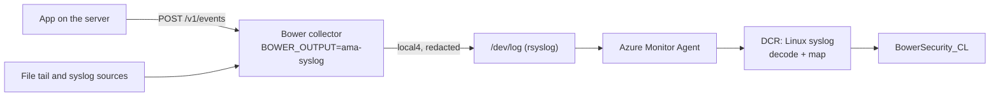

# Quick start: Azure with Azure Monitor Agent

Use this when your Linux servers already run Azure Monitor Agent (AMA): Azure VMs, scale sets,
or Azure Arc-enabled servers anywhere. Bower runs on each server, selects and redacts the
security events, then hands them to the local syslog daemon. AMA's syslog collection carries
them to the same `BowerSecurity_CL` table in Sentinel. Bower needs no Azure credential on the
server; AMA's managed identity does the upload.



Settings, sizes, failure codes and limits are in the
[syslog output reference](../deployment/ama-syslog-output.md). This page is the steps.

**Moving a server from `azure-logs-ingestion` or `ama-spool`?** Do the steps in order. Bower
counts an event delivered as soon as the local daemon takes it, so if you switch the output
before the rule is associated, those events are removed from Bower's queue and never uploaded.

## Before you choose this path

- Any local account on the server can write rows into `BowerSecurity_CL` on this path, past
  Bower's policy and redaction, unless you install the origin filter in step 3 (then root and
  the `bower` account still can). Where local accounts are not trusted, use
  `BOWER_OUTPUT=azure-logs-ingestion` ([Azure ingestion API](../deployment/logs-ingestion-api.md)).
- Bower cannot confirm arrival here: only a Sentinel query can. Events larger than 5,730 bytes
  of JSON are refused. Compare the three Azure paths in
  [Which Azure path](../deployment/ama-syslog-output.md#which-azure-path).
- Windows servers: use `azure-logs-ingestion`; this output is refused on Windows.

## Before you begin

- The Bower Sentinel resources from `deploy/bicep/main.bicep`, which create the
  `BowerSecurity_CL` table. See [Azure ingestion API](../deployment/logs-ingestion-api.md).
- AMA installed on the server.
- A free syslog facility for Bower. The default is `local4`; pick another of `local0` to
  `local7` if something on the server already uses it.
- Bower installed from the [deb or rpm package](../deployment/installers.md), with its output
  left as it is for now.

## 1. Create the collection rule

**On an admin workstation** with the Azure CLI and a checkout of this repository:

```bash
# Preview first; nothing is created until you run "create".
az deployment group what-if --resource-group rg-sentinel \
  --template-file deploy/bicep/ama-syslog-dcr.bicep \
  --parameters workspaceName=law-sentinel

az deployment group create --resource-group rg-sentinel --name bower-ama-syslog \
  --template-file deploy/bicep/ama-syslog-dcr.bicep \
  --parameters workspaceName=law-sentinel
```

Add `workspaceResourceGroup=...` if the workspace is in another resource group, and
`facility=local5` (for example) if you will not use `local4`. The rule must be in the
workspace's region: add `location=<workspace region>` when the resource group is in another
region. For Private Link, see
[the collection rule](../deployment/ama-syslog-output.md#the-collection-rule) first: each machine
also needs its own endpoint association.

## 2. Associate the rule with each server

**On the admin workstation:**

```bash
RULE_ID=$(az deployment group show --resource-group rg-sentinel --name bower-ama-syslog \
  --query properties.outputs.dataCollectionRuleId.value -o tsv)

az monitor data-collection rule association create \
  --name bower-ama-syslog \
  --rule-id "$RULE_ID" \
  --resource <vm-or-arc-machine-resource-id>
```

`bower-ama-syslog` in `az deployment group show` is the deployment name from step 1. The
association name is per machine, so the same name works on every server. For many servers, assign the built-in Azure
Policy definition **Configure Linux Machines to be associated with a Data Collection Rule or a
Data Collection Endpoint**
([Microsoft](https://learn.microsoft.com/en-us/azure/azure-monitor/policy-reference)), with this
rule's ID.

AMA then writes its rsyslog forwarding file and restarts rsyslog
([Microsoft](https://learn.microsoft.com/en-us/azure/azure-monitor/vm/data-collection-syslog)).

## 3. Prepare the server

**On the server:**

```bash
systemctl is-active rsyslog                  # must print "active"
ls /etc/rsyslog.d/ | grep azuremonitoragent  # the agent's forwarding file
```

If rsyslog is not installed, install it (`sudo dnf install rsyslog` or `sudo apt install
rsyslog`) and enable it, then wait for the agent to write its file. Microsoft documents the file
as `10-azuremonitoragent-omfwd.conf`, and that is the name agent 1.45.1 wrote on Oracle Linux
9.8 and Ubuntu 24.04 in the live run (#249). It appears a few minutes after the association.
Do not go on until it exists.

Then raise the limits that drop bursts and, if you want them, install the filters. Copy the
files from
[`examples/cloud-agents/azure`](https://github.com/jusso-dev/Bower/tree/main/examples/cloud-agents/azure);
each file says where it goes and how it was tested.

| File | Where | Why |
|---|---|---|
| `bower-ama-syslog-ratelimit.conf` | `/etc/systemd/system/bower.service.d/ama-syslog-output.conf` | journald's limit for `bower.service` only |
| `rsyslog-imjournal-ratelimit.conf` | edit `/etc/rsyslog.conf` (RHEL, Rocky, AlmaLinux) | rsyslog's host-wide limit of about 33 events per second |
| `sysctl-bower-syslog.conf` | `/etc/sysctl.d/60-bower-syslog.conf` (Debian, Ubuntu) | journald's forward to rsyslog drops messages in a burst |
| `rsyslog-bower-origin-imjournal.conf` or `rsyslog-bower-origin-imuxsock.conf` | `/etc/rsyslog.d/09-bower-origin.conf` | Only `bower.service` can write rows ([why](../deployment/ama-syslog-output.md#who-can-write-to-the-table)) |
| `rsyslog-bower-local-copies.conf` | `/etc/rsyslog.d/11-bower-local-copies.conf` | Keeps Bower events out of `/var/log/messages` and `/var/log/syslog` ([why](../deployment/ama-syslog-output.md#what-stays-on-the-server)) |

```bash
sudo rsyslogd -N1                              # the configuration is valid
sudo systemctl daemon-reload
sudo systemctl restart rsyslog
```

## 4. Switch Bower's output

**On the server**, in `/etc/bower/bower.env`, uncomment the syslog block (or add these lines):

```bash
BOWER_OUTPUT=ama-syslog
#BOWER_AMA_SYSLOG_FACILITY=local4          # match the rule's facility parameter
#BOWER_AMA_SYSLOG_MAX_BYTES=7680           # at least 512 below rsyslog's MaxMessageSize
```

```bash
sudo systemctl restart bower
bower doctor --syslog-socket /dev/log
```

## 5. Send a test event and check it

**On the server:**

```bash
bower test emit
```

It sends a new synthetic authentication failure each time and prints the collector's answer,
including `"eventId"`.

On a fresh install the collector answers `403` ("Producer is not authorized for this event
identity"): producer scopes are default deny, and nothing is allowed to claim the canary's
identity yet. For the test, allow it for the loopback producer in a scopes file, then restart
Bower (see [Producer identity scopes](../security/producer-scopes.md)):

```bash
sudo tee /etc/bower/producer-scopes.json >/dev/null <<JSON
[{"producer": "anonymous",
  "application": {"name": "BowerCanary", "environment": "test", "instance": "$(cat /proc/sys/kernel/hostname)"},
  "source": {"ipAddress": "192.0.2.1"}}]
JSON
sudo chown root:bower /etc/bower/producer-scopes.json && sudo chmod 0640 /etc/bower/producer-scopes.json
echo 'BOWER_PRODUCER_SCOPES_FILE=/etc/bower/producer-scopes.json' | sudo tee -a /etc/bower/bower.env
sudo systemctl restart bower
```

Use `"producer": "default"` instead when the collector has a shared ingest token. Add your
applications' identities to the same file. If the collector has an ingest token, pass it from
the file without printing it:

```bash
sudo sh -c 'BOWER_INGEST_TOKEN="$(cat /etc/bower/secrets/ingest-token)" bower test emit'
```

Check that it reached the local daemon:

```bash
journalctl -t bower -n 1 -o cat
```

**In Sentinel**, after a few minutes, with the ID it printed:

```kusto
BowerSecurity_CL
| where EventId == "<eventId from bower test emit>"
```

If the row does not arrive, split the path in half:

1. Not in `journalctl -t bower`: check Bower's status, `curl -s http://127.0.0.1:4319/v1/status`
   (with `-H "Authorization: Bearer ..."` if a token is set) and its
   `deliveryActivity.lastFailureCode`.
2. In the journal but not in Sentinel: check that the agent's file is in `/etc/rsyslog.d/`, that
   no earlier rsyslog rule discards the facility, the rule association, and
   `/var/opt/microsoft/azuremonitoragent/log/mdsd.err`.

## Remove

1. **Server:** set `BOWER_OUTPUT` to another output (or `none`) and restart Bower first, so
   no events are handed to a daemon that no longer forwards them. Remove the files from step 3
   if you added them.
2. **Admin workstation:** delete the association on each server, then the rule (named
   `<namePrefix>-ama-syslog-dcr`):

    ```bash
    az monitor data-collection rule association delete --name bower-ama-syslog \
      --resource <vm-or-arc-machine-resource-id>
    az monitor data-collection rule delete --resource-group rg-sentinel \
      --name bower-ama-syslog-dcr
    ```

Rows already in `BowerSecurity_CL` stay until the table's retention removes them.

## Limits

- Linux with rsyslog only. See the [reference](../deployment/ama-syslog-output.md#limits).
- This path was run once end to end with real Azure Monitor Agents (1.45.1) on Oracle Linux
  9.8 and Ubuntu 24.04 (#249): test events, 5,000-event bursts and the shipped filters. The
  results are in the [reference](../deployment/ama-syslog-output.md). It was also run once
  behind Private Link. Arc machines, syslog-ng and other agent versions were not run.
