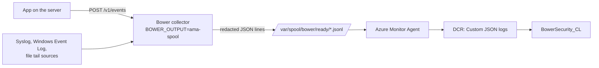

# Quick start: Azure with Azure Monitor Agent

Use this when your servers already run Azure Monitor Agent (AMA): Azure VMs, scale sets, or
Azure Arc-enabled servers anywhere. Bower runs on the server in **companion mode**. It
selects and redacts the security events, then writes them to a spool directory. AMA picks up
the spool files and uploads them to the same `BowerSecurity_CL` table in Sentinel. Bower
needs no Azure credential on the server; AMA's managed identity does the upload.



Bower doesn't replace or modify AMA. Keep AMA collecting whatever it already collects; this
adds one more data collection rule (DCR).

## Before you begin

- The Bower Sentinel resources from `deploy/bicep/main.bicep`, which create the
  `BowerSecurity_CL` table. See [Azure ingestion API](../deployment/logs-ingestion-api.md).
- A data collection endpoint (DCE) in the workspace's region. `main.bicep` creates one
  (`bower-dce`); AMA custom log collection needs a DCE on the rule.
- AMA installed on the server. The rule assignment in step 3 installs nothing.

## 1. Install Bower in companion mode

Install the [deb, rpm or MSI package](../deployment/installers.md), then set the output in
`/etc/bower/bower.env` ([example](https://github.com/jusso-dev/Bower/blob/main/examples/cloud-agents/azure/bower.env)):

```bash
BOWER_OUTPUT=ama-spool
BOWER_AMA_SPOOL_PATH=/var/spool/bower
BOWER_LISTEN_URL=http://127.0.0.1:4319
```

On Windows the MSI already sets `BOWER_AMA_SPOOL_PATH` to `C:\ProgramData\Bower\spool`;
set `BOWER_OUTPUT=ama-spool` in the service environment.

Restart the service (`sudo systemctl restart bower`). Bower writes each batch to
`active/`, flushes it, and renames it into `ready/` only when it is complete, so AMA never
reads a half-written file. See [AMA companion mode](../deployment/ama-companion.md).

!!! note "Let AMA read the spool"
    The packages create `/var/spool/bower` as `bower:bower 0750`, and Bower keeps `ready/`
    and its files readable by the `bower` account only. Grant the account AMA runs as
    read access, for example with an ACL:

    ```bash
    ps -o user= -C fluent-bit          # the account AMA reads files as
    sudo setfacl -m u:<that-account>:rx /var/spool/bower /var/spool/bower/ready
    sudo setfacl -d -m u:<that-account>:r /var/spool/bower/ready
    ```

    On Windows, AMA runs as Local System and can already read `C:\ProgramData\Bower\spool`.

## 2. Create the collection rule

Deploy [`deploy/bicep/ama-spool-dcr.bicep`](https://github.com/jusso-dev/Bower/blob/main/deploy/bicep/ama-spool-dcr.bicep).
It declares the spool's JSON lines with the same columns and transformation as
`main.bicep`, so rows from AMA and rows from the Logs Ingestion API look the same.

```bash
# Preview first; nothing is created until you run "create".
az deployment group what-if --resource-group rg-sentinel \
  --template-file deploy/bicep/ama-spool-dcr.bicep \
  --parameters workspaceName=law-sentinel \
               dataCollectionEndpointId=$(az monitor data-collection endpoint show \
                 --resource-group rg-sentinel --name bower-dce --query id -o tsv)

az deployment group create --resource-group rg-sentinel \
  --template-file deploy/bicep/ama-spool-dcr.bicep \
  --parameters workspaceName=law-sentinel dataCollectionEndpointId=<dce-resource-id>
```

The default file patterns are `/var/spool/bower/ready/*.jsonl` and
`C:\ProgramData\Bower\spool\ready\*.jsonl`. Override `filePatterns` if you changed
`BOWER_AMA_SPOOL_PATH`.

## 3. Associate the rule with your servers

```bash
az monitor data-collection rule association create \
  --name bower-ama-spool \
  --rule-id <dataCollectionRuleId output> \
  --resource <vm-or-arc-machine-resource-id>
```

For many servers, assign the rule with Azure Policy or associate it in the portal under
**Monitor > Data collection rules > bower-ama-spool-dcr > Resources**.

## 4. Send a test event and check it

```bash
curl -s -X POST http://127.0.0.1:4319/v1/events \
  -H 'Content-Type: application/json' \
  --data-binary @examples/cloud-agents/sample-event.jsonl
ls /var/spool/bower/ready/
```

Then, after a few minutes, in Sentinel:

```kusto
BowerSecurity_CL
| where EventId == "7f9c2b1e-5d4a-4c3b-9a8e-1f2d3c4b5a69"
```

Use a fresh `eventId` for each test; Bower treats a repeated ID as the same event.

## 5. Clean up collected files

Bower doesn't delete ready files, because a file in `ready/` only means Bower handed the
events over, not that AMA uploaded them. Azure Monitor recommends leaving at least two days
before deleting collected files. The
[`bower-spool-cleanup` timer](https://github.com/jusso-dev/Bower/blob/main/examples/cloud-agents/azure/bower-spool-cleanup.timer)
deletes files older than three days:

```bash
sudo cp examples/cloud-agents/azure/bower-spool-cleanup.{service,timer} /etc/systemd/system/
sudo systemctl enable --now bower-spool-cleanup.timer
```

Watch the count and age of files in `ready/`: a growing backlog means AMA isn't collecting.

## When to use something else

- No AMA on the server, or you want Bower to confirm each upload: use
  `BOWER_OUTPUT=azure-logs-ingestion` with a managed identity. See
  [Azure ingestion API](../deployment/logs-ingestion-api.md).
- Many servers sending syslog or Windows events: run one collector and point the servers
  at it. See [syslog](../deployment/syslog-source.md) and
  [Windows Event Forwarding](../deployment/windows-event-forwarding.md).

## Limits

- AMA acknowledges nothing back to Bower. Bower's queue counts an event as delivered once it
  is in `ready/`; only the Sentinel query proves arrival.
- AMA's custom JSON log collection supports file patterns with wildcards in the file name
  and one folder level, and up to about 10 monitored directories per machine. Keep the
  spool on a local disk.
- This path has been validated by building and linting the Bicep and by Bower's DCR schema
  tests. It has not been deployed against a live workspace by the Bower test suite.
