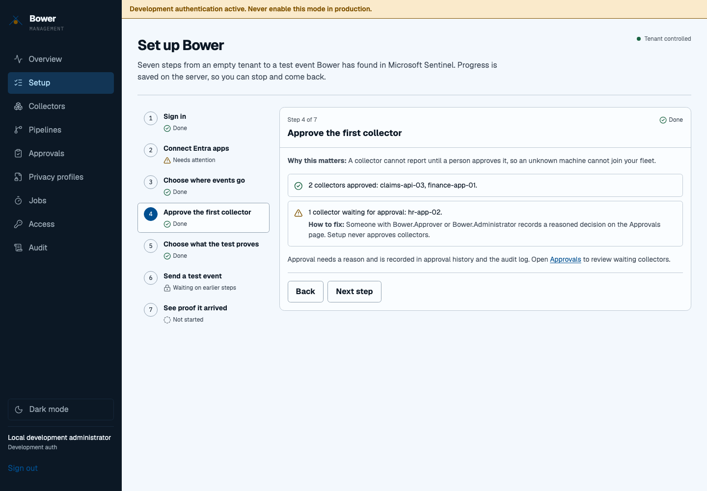

# Your first verified event

**Goal:** send a harmless test event and find it in Microsoft Sentinel.
You do not need real customer data for this walkthrough.

## Before you begin

Ask the person managing your environment for:

- A deployed [management console](../deployment/console-image.md) and collector.
- A Microsoft Entra account with the `Bower.Administrator` role for setup changes.
- A Log Analytics workspace connected to Sentinel, with the required table and data collection rule.
- An ingestion identity and a separate read-only verifier identity configured by your administrator.

If you only have viewing access, you can follow the checklist. Ask an administrator
to make changes. [Understand the roles](../security/management-identity-and-rbac.md).

## 1. Open Setup

Sign in to your organisation's console and choose **Setup**. In simple view, select
**Show technical pages** first. The seven-step wizard saves progress on the server.
You can leave and come back, or see the same progress under **Help → Setup checklist**.

## 2. Connect your identity and destination

Follow **Sign in**, **Connect Entra apps** and **Choose where events go**. Your
administrator supplies the workspace ID, table and DCR details. Use **Check the
rule and table** to check the destination configuration. Saving IDs alone does not
prove that events can arrive.

## 3. Approve the first collector

Check the machine's identity in **Approvals**, then record an approval with a reason.
Only approve a machine you recognise. Return to Setup to see updated progress.

## 4. Choose a test and send it

In **Choose what the test proves**, start with the generic test event. Select
**Send a test event**. Bower uses synthetic data and the same privacy, policy, queue
and delivery path used for normal events.

## 5. Read the result

| Result | What it means | What to do |
| --- | --- | --- |
| Verified in Sentinel | The query found the exact test event. | Download the evidence bundle and record the test. |
| Simulated, not proof | The test did not query Sentinel. | Ask your administrator to configure the read-only verifier, then repeat the test. |
| Needs attention | A configuration, delivery or verification step failed. | Follow the suggested fix shown in the wizard. |
| In progress | The test is still running. | Keep the page open or return later; the result is stored on the server. |

Do not use a green collector heartbeat as evidence of Sentinel delivery.
An evidence bundle is signed only when your administrator has configured a signing
key; otherwise, it is unsigned. See [evidence bundles](../operations/evidence-bundles.md)
for verification details.

## Next: connect a real source

Use [Sources](../operations/console-sources.md) to choose a supported source, review
its protected preview and request approval. A different person approves the request.
An operator then applies the signed configuration to the machine.

For the full setup reference, see [console onboarding](../operations/console-onboarding.md).
