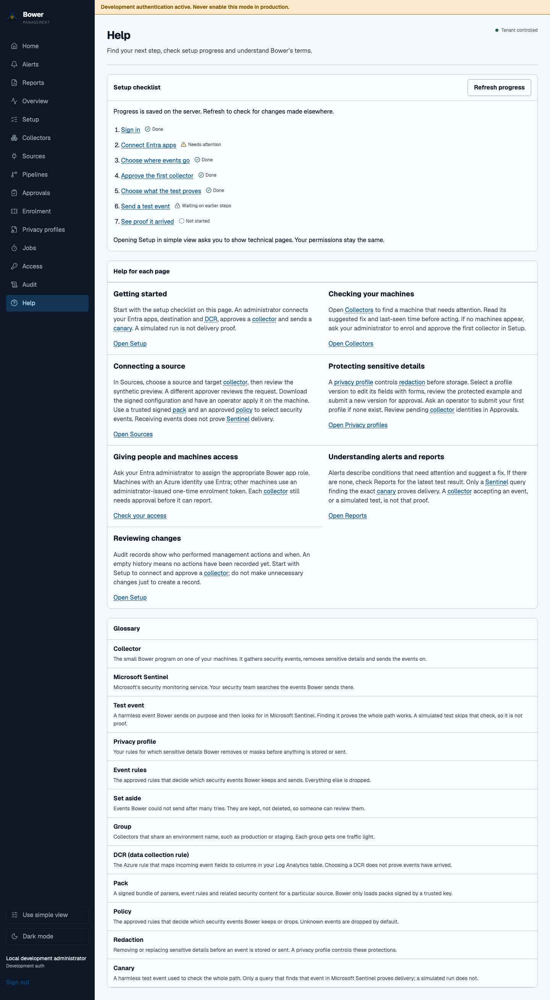
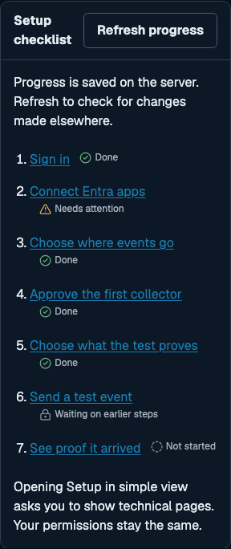

# Help in the management console

Every operational page has a **Help with this page** link. It opens the relevant
local guide and moves keyboard focus to its heading. Help contains next steps for
setup, fleet health, sources, privacy, access, alerts, reports and audit history.
Empty views explain what to do next; they do not create sample fleet data.

## Check setup progress

Open **Help → Setup checklist** to see the steps saved by the onboarding API.
The checklist reads the server on each visit. **Refresh progress** checks changes
made by another person without losing the current page. A failed refresh explicitly
marks the last loaded progress as potentially out of date. If the first request
fails, the guides and glossary remain available and the checklist can be retried.

Select a step to open that part of Setup. In simple view, choose **Show this
technical page** to continue. This changes navigation only: viewers still cannot
change setup. Only a Bower administrator can complete the configuration steps.
Progress is never saved in browser storage or inferred from clicks.

A simulated canary is labelled **Simulated, not proof**. Only the server's verified
Sentinel query result can complete the proof step. A heartbeat or collector
acceptance alone is not delivery proof.

## Understand a term

DCR, pack, policy, redaction, canary and collector have plain-English definitions,
alongside the other console terms. In guided text, focus a dotted link with the
keyboard or hover over it to read a tooltip. Escape dismisses it. Follow the link
(on a touch screen, tap it) to focus the full glossary entry.

The typed glossary data ships as `src/components/glossary.json` in the web app.
There are no external help widgets, tracking requests or additional scripts. Help
uses the existing authenticated read-only setup endpoint; no new trust boundary or
permission is introduced, and the Content Security Policy is unchanged.

