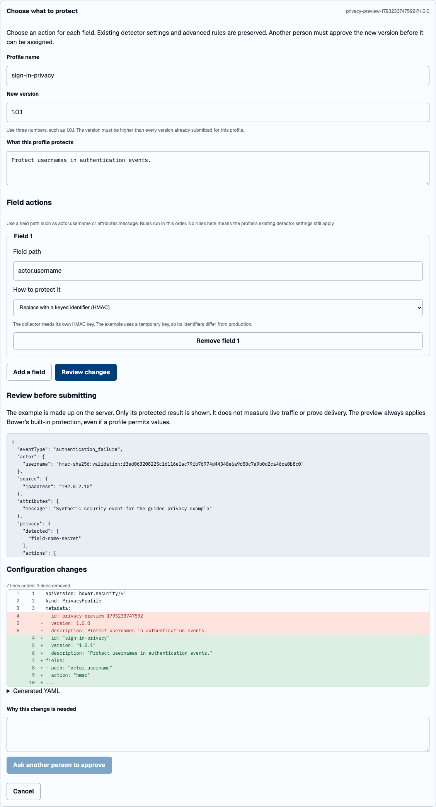

# Change privacy actions with forms

Open **Privacy profiles**, select a version, then choose **Edit with forms**.
With no versions yet, Bower opens a new profile. Give it a name and a version
such as `1.0.0`. For an existing profile, raise the version, for example to
`1.0.1`. Submitted versions are immutable.

Choose **Add a field**, enter a path such as `actor.username`, and choose how to
protect it. You can redact, mask, remove, shorten or pseudonymise the value.
HMAC requires a key configured on the collector; never enter that key in the
console. Truncation retains part of a value and may retain identifying information.
Rules run in the order shown.

**Review changes** validates the generated YAML with the collector's strict
loader and checks the version against stored versions. Existing detector
overrides, custom detectors, secret field names and other advanced settings are
preserved. The form changes metadata and field rules only. YAML comments and
formatting may be rewritten; inspect the displayed diff before submitting.

The example is synthetic and server-owned. Only the protected result is returned.
Bower's built-in protection also applies to the preview, even when a candidate
permits a value. A temporary HMAC key means example identifiers change between
checks and never match production. This example does not measure live event
populations or prove Sentinel delivery. Custom fields absent from the example
will not demonstrate their effect here.

Enter a reason and choose **Ask another person to approve**. The existing
version review and assignment flow applies: the author cannot approve their own
version, and only an administrator assigns an approved version to collectors.
Editing a field invalidates the previous review, including results from requests
that were already in flight. Nothing is saved in browser storage.

The YAML editor remains available through **Submit new version** for custom
detectors and advanced rules. The form endpoint is `POST /api/privacy-profiles/form`,
requires the Operate policy, limits requests to 640 KiB and accepts at most 128
field rules. It reads no files or network addresses supplied by a user.

This is the privacy editing portion of #100. Policy decisions, suppression and
population comparisons against pack samples remain part of that ticket.
