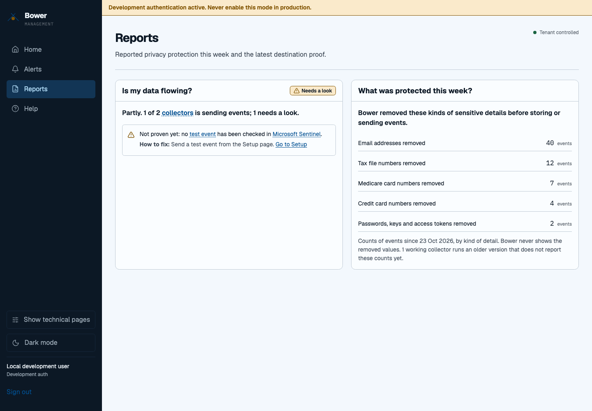

# A simpler view of Bower

People with only the Viewer role start with four pages:

- **Home** answers whether data is flowing, what was protected and what needs attention.
- **Alerts** lists current issues and suggested fixes from the management server.
- **Reports** shows this week's reported privacy counts and the latest destination proof.
- **Help** explains unfamiliar terms.

These views use the same authenticated management data as the detailed console.
They never invent a successful delivery: a collector accepting an event is
different from finding it in Sentinel. Missing counters and unverified or simulated
proof remain labelled. A failed refresh keeps the last result with its timestamp.

Choose **Show technical pages** in the navigation to see the detailed fleet,
configuration and audit pages. A direct link to a technical page first explains
that it is hidden and offers the same choice. **Use simple view** hides them again.
The choice persists in this browser per tenant and signed-in user. The preference
contains only `simple` or `detailed`; it stores no token, credential or telemetry.

Operators, approvers and administrators start in detailed view and can also choose
the simpler view. The toggle changes presentation only. A viewer remains read-only
on every technical page, and the API still rejects write requests. If the access
check fails, technical pages remain unavailable until it succeeds.

The report page is a current summary, not a historical evidence export. Privacy
counts cover only reporting collectors and the displayed time window. Use the
onboarding destination check for query-verified delivery evidence.
