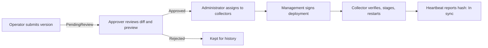

# Managed privacy profiles

The management console and API keep every **privacy profile version** as an
immutable, reviewed record and deliver approved versions to collectors with a
signature. Use this instead of copying YAML to each host when you want:

- every change versioned and diffable, with author, reviewer and reasons recorded;
- a second person to approve every version (two-person rule);
- one place to assign a version to collectors and see which ones are running it.

How to write the YAML itself: [custom redaction rules](custom-redaction-rules.md).



## Lifecycle and roles

| Step | Who (Entra app role) | Console | API |
|---|---|---|---|
| Validate and preview | `Bower.Operator`, `Bower.Approver`, `Bower.Administrator` | **Privacy profiles → Submit new version → Validate / Preview** | `POST /api/privacy-profiles/validate`, `/preview` |
| Submit for review | Operator, Approver, Administrator | **Submit for review** with a change summary | `POST /api/privacy-profiles` |
| Approve or reject | `Bower.Approver`, `Bower.Administrator`, **not the author** | Version detail → **Review** | `POST /api/privacy-profiles/versions/{id}/approve` or `/reject` |
| Assign to collectors | `Bower.Administrator` | Version detail → **Assign to collectors** | `POST /api/collectors/{id}/privacy-profile` |
| Clear an assignment | `Bower.Administrator` | **Collector sync status → Clear assignment** | `POST /api/collectors/{id}/privacy-profile/clear` |
| View versions, history, sync status | any interactive role | **Privacy profiles** | `GET /api/privacy-profiles`, `/versions/{id}`, `/assignments` |

The API enforces every rule; the console only hides controls you cannot use.

- **Versions are immutable.** `metadata.version` must be `MAJOR.MINOR.PATCH` and
  greater than every earlier version of the same `metadata.id`, including rejected
  ones. To change anything, submit a new version.
- **Two-person rule.** The reviewer's Entra object id must differ from the author's,
  whatever their roles (`409 The author of a privacy profile version cannot review it.`).
- Only versions pending review can be decided. Only approved versions can be
  assigned. Revoked collectors cannot be assigned.
- Every submission, decision, assignment and clear needs a reason (1–500
  characters) and writes a management audit row in the same transaction:
  `privacy-profile.submitted`, `privacy-profile.approved`, `privacy-profile.rejected`,
  `collector.privacy-profile-assigned`, `collector.privacy-profile-cleared`.

### Reviewing a version

The version detail shows the full YAML and a line diff against the previous
approved version of the same privacy profile. Before approving, check:

1. each custom detector's `description`, `pattern`, `tests.match` and
   `tests.noMatch` (they ran when the version was submitted);
2. any action weakened to `allow` or `alert-only`, detectors added to `disabled`,
   or a larger `maximumFieldLength`;
3. a **Preview** with a representative, synthetic sample event.

Preview runs in memory with a fresh random HMAC key, so pseudonyms never match
production. Nothing in a preview is stored or logged. Do not paste real personal
data into a preview.

## Set up signing

Collectors only accept deployments signed by a key they trust.

```bash
bower keys generate --out-dir ./profile-signing
```

- Management API: `BOWER_MANAGEMENT_PROFILE_SIGNING_KEY_FILE=<private PEM>`.
  Without it, everything else works but deployments return `503`. A file that is
  not a readable P-256 private key stops the API at start-up.
- Collectors: `BOWER_MANAGED_PRIVACY_TRUSTED_KEYS=<public PEM>[,<public PEM>…]`.

Store the private key like any signing key. To rotate, add the new public key to
collectors first, then switch the management key.

## Configure collectors

```text
BOWER_PRIVACY_PROFILE_SOURCE=management
BOWER_MANAGEMENT_ENDPOINT=https://bower-management.example.gov.au
BOWER_MANAGEMENT_SCOPE=api://<management-api-client-id>/.default
BOWER_MANAGED_PRIVACY_TRUSTED_KEYS=/etc/bower/profile-signing.pub.pem
# Only if a version uses hmac:
BOWER_PRIVACY_HMAC_KEY_FILE=/etc/bower/privacy-hmac.key
BOWER_PRIVACY_HMAC_KEY_ID=k1
```

| Variable | Default | Purpose |
|---|---|---|
| `BOWER_PRIVACY_PROFILE_SOURCE` | `local` | `management` takes the privacy profile from management. Cannot be combined with `BOWER_PRIVACY_PROFILE` or a pack privacy profile |
| `BOWER_MANAGED_PRIVACY_TRUSTED_KEYS` | — | Required in management mode. Public keys trusted to sign deployments |
| `BOWER_MANAGED_PRIVACY_DIRECTORY` | `managed-privacy` next to the queue database | Verified cache (`profile.json`). Keep it on persistent storage |

Both the .NET and Rust collectors support management mode with identical settings,
cache format and signature checks.

### What the collector does

The `managed-privacy-profile` background job runs every minute:

| Management answers | Collector |
|---|---|
| Same version as active | Nothing |
| A new signed version | Verifies the signature, that it is addressed to this collector, that the YAML loads (all custom detector tests pass, HMAC key present if needed) and that its hash matches. Then writes it to the cache atomically and **restarts** |
| No assignment (`204`) | Deletes the cache and restarts with the built-in default privacy profile |
| Collector not active yet (`409`) | Nothing |
| Anything else, or verification fails | Keeps the current privacy profile; the job shows `Failed`. Unverified content is never written |

At start-up a cached version is verified again. A cache that fails verification
stops the collector with an explanation (delete the file to start with the built-in
default). With no cache, the built-in default privacy profile applies.

**Restarts.** The collector applies a new version by stopping gracefully and
exiting with code `75`. The queue is durable, so nothing is lost. A supervisor
must start it again: Docker `restart: unless-stopped` (the shipped compose files),
systemd `Restart=on-failure` (the shipped unit), or a Kubernetes pod. Expect up to
a minute plus a restart before an assignment is active.

### Sync status

Collectors report their active privacy profile hash in every heartbeat. The console
shows each collector as **In sync** (running the assigned version), **Drift**
(assigned but running something else, including collectors not yet in management
mode), or **Unassigned**. `/v1/status` on the collector shows `privacyProfile`,
`privacyProfileVersion`, `privacyProfileHash` and `privacyProfileSource`.

## Automation

The same workflow from PowerShell (`Bower.Management` module):

```powershell
Connect-BowerManagement -Endpoint https://bower-management.example.gov.au -Audience api://<api-client-id>
Submit-BowerPrivacyProfile -Path ./contoso.privacy.yaml -ChangeSummary 'Add custom.employee-id'
Get-BowerPrivacyProfileVersion -Status PendingReview
Approve-BowerPrivacyProfileVersion -Id <id> -Reason 'Reviewed diff and preview, CHG-210'   # another person
Set-BowerCollectorPrivacyProfile -CollectorId web-07 -VersionId <id> -Reason 'Roll out CHG-210'
Get-BowerPrivacyProfileAssignment
```

## Security notes

- Deployments are signed with ECDSA P-256 over canonical JSON that includes the
  collector id, so a version assigned to one collector cannot be replayed to another.
- The "no assignment" answer is not signed. Someone able to impersonate the HTTPS
  management endpoint could make a collector fall back to the built-in default
  privacy profile, never to content of their choosing. HTTPS is required for
  non-loopback management endpoints.
- After writing the cache, the Rust collector also flushes the directory entry to
  disk; the .NET collector does not. If a power loss undoes the rename, the
  collector restarts with the previous version and stages the new one again on the
  next sync.
- Profiles carry no secrets. HMAC keys stay on the hosts.
